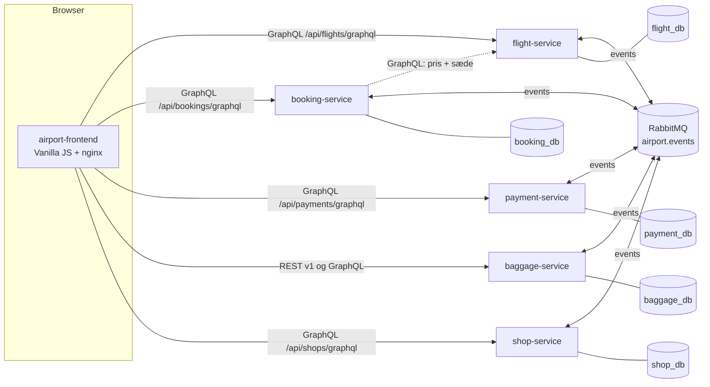
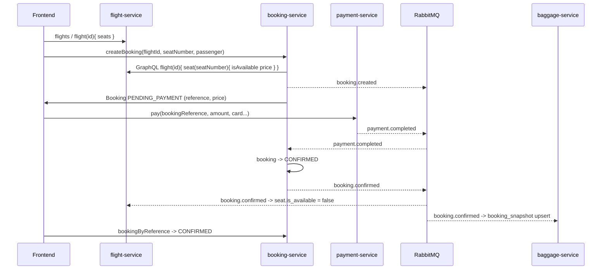
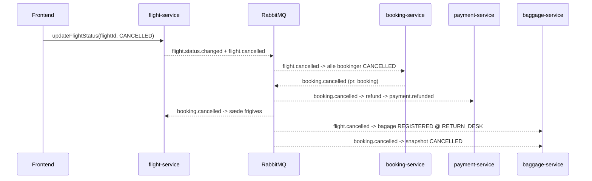
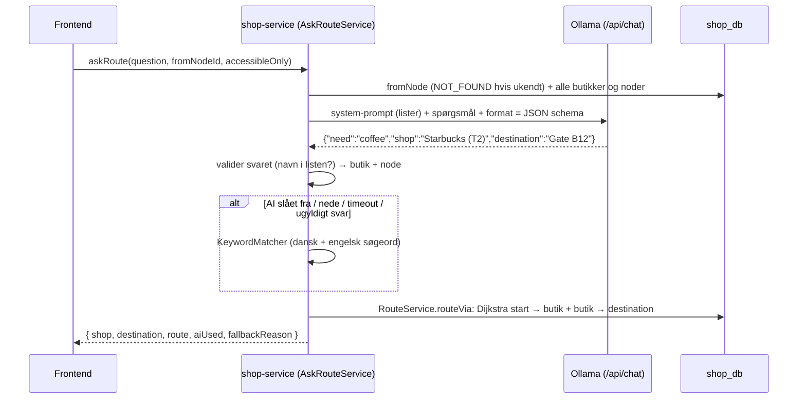

# Arkitektur

## Overblik



```
  [Frontend]  --GraphQL-->  [Flight Service]   ---> flight_db
              --GraphQL-->  [Booking Service]  ---> booking_db   --GraphQL--> Flight Service (pris/sæde)
              --GraphQL-->  [Payment Service]  ---> payment_db
              --REST/GraphQL--> [Baggage Service]  ---> baggage_db
              --GraphQL-->  [Shop Service]     ---> shop_db

  Alle backend-services <--events--> [RabbitMQ: topic exchange "airport.events"]
```

Regler der overholdes:

* Én PostgreSQL-database pr. service. Ingen service læser i en anden services database.
* Synkront: frontend → service via GraphQL over HTTP (Spring for GraphQL) og REST v1 for bagage.
* Asynkront: service → service via events på RabbitMQ (se [events.md](events.md)).
* Services cacher snapshots fra events (fx booking gemmer flightnummer, afgangstid, gate og flystatus;
  baggage gemmer `booking_snapshot`). Kilden til sandhed er altid den ejende service.
* Frontend kalder services direkte. I docker-compose via `localhost:808x` med CORS; i Kubernetes via
  én Ingress, hvor frontend og API deler origin.

## Teknologi pr. service

Alle fem backend-services er bygget over samme skabelon (flight-service var den første og de øvrige er
kopier af strukturen):

| Lag         | Pakke        | Indhold                                                                 |
|-------------|--------------|-------------------------------------------------------------------------|
| domain      | `.domain`    | JPA-entiteter, enums, `ApiException` + `ErrorCode`                      |
| repository  | `.repository`| Spring Data JPA repositories (+ Specifications hvor der filtreres)      |
| service     | `.service`   | Forretningslogik, transaktioner, ren domænelogik (pris, regler, Dijkstra) |
| graphql     | `.graphql`   | `@Controller` med `@QueryMapping`/`@MutationMapping`/`@SchemaMapping`, input-records med Bean Validation, `GraphQlExceptionResolver` |
| messaging   | `.messaging` | `EventEnvelope`, `EventPublisher` + `OutboxEvent`/`OutboxRelay` (transactional outbox), consumers + transaktionelle handlers, `ProcessedEvent` (idempotens) |
| config      | `.config`    | RabbitMQ-topologi (exchange, køer, DLQ), GraphQL-scalars, `SecurityConfig` + `KeycloakRoleConverter` (JWT, roller, CORS – se [Sikkerhed](#sikkerhed-login-og-roller)) |

Skema og seed-data styres af Flyway (`V1__init.sql`, `V2__seed.sql`, `V{n}__outbox.sql`); Hibernate kører med
`ddl-auto=validate`.

### API-versionering

REST-kontrakten har major-versionen i stien `/api/baggage/v1`. Bagudkompatible tilføjelser, fx et valgfrit felt,
kan leveres i v1. En breaking change, fx et omdøbt eller fjernet svarfelt, får en ny sti under
`/api/baggage/v2`. v1 kører parallelt, mens klienterne migrerer. `/api/baggage/v3/api-docs` er stien til
OpenAPI-dokumentet. Forretnings-API'ets version fremgår af de dokumenterede operationer.

GraphQL beholder sin eksisterende endpoint-sti. Skemaet får nye felter eller operationer, og en forgænger
markeres med `@deprecated(reason: "...")` med en henvisning til erstatningen.

REST og GraphQL kalder begge `BaggageService` og bruger samme data, regler og fejlkoder. REST sender
koden som `code` i `application/problem+json` med en HTTP-status, fx `400` for `VALIDATION_ERROR`,
`404` for `NOT_FOUND` og `409` for `INVALID_STATE`, `BAGGAGE_LIMIT_EXCEEDED` og `CONFLICT`.
Keycloak-rollerne er fælles. API'erne kan bruges på den samme bookingreference og det samme bagagetag.

### CQRS i booking-service

**Min booking** er en læsetung visning. Før skulle klienten hente booking, betalinger og bagage fra tre
services. Nu beder den kun booking-service om `bookingOverview(reference)`. Queryen læser én række i
`booking_overview` via bookingreferencen. Rækken indeholder booking og passager, senest observerede
betalingsstatus, antal unikke bagagetags og de betalings- og bagagelinjer, som siden viser.

`BookingCommandService` håndterer kommandoer og domæneændringer. `BookingQueryService` håndterer læsninger.
Den almindelige booking-API har stadig sine queries, og de øvrige sider kan fortsat bruge service-API'erne.
GraphQL-opslaget kræver login. En passager har adgang til egne oversigter, og `OPERATIONS` kan slå flere op.

- Bookingændringer kopieres til projektionen i samme databasetransaktion som kommandoen.
- `payment.completed`, `payment.failed`, `payment.refunded`, `baggage.registered` og `baggage.status.changed`
  opdaterer projektionen via RabbitMQ. Behandlede event-id'er registreres i samme transaktion som ændringerne.
  Betalinger identificeres med betalings-id og bagage med tag. En statusændring øger derfor ikke bagagetallet for et kendt tag.
- Betalings- og bagageoplysninger er eventual consistent. Siden kan kortvarigt vise en ældre status, mens events er på vej.
  Flyway fylder eksisterende bookinger og passagerer fra bookingdatabasen. Historiske betalings- og bagagelinjer
  kræver genafspilning af events fra deres kildeservices for at blive vist fuldt ud.

Læsemodellen er afledte data. Det gør det muligt at flytte eller replikere den og skalere læsninger uafhængigt
af kommandoerne senere. I den nuværende deployment bruger begge sider samme PostgreSQL-database i booking-service.

### Logging og monitoring

Alle fem backendservices skriver JSON-logs i Compose og Kubernetes. Micrometer Tracing med OpenTelemetry
sætter `traceId` og `spanId` i logkonteksten for HTTP-requests og RabbitMQ-events. Frontenden bruger samme
W3C-trace til oprettelse, betaling og bagageregistrering for en booking i samme browsersession. Hvert kald
har sit eget span. Booking-service bruger Spring Boots instrumenterede `RestClient.Builder`, så opslag
på sædet i flight-service også får trace-konteksten.

En outbox-række gemmer `traceparent` sammen med eventet. Den planlagte relay sender den gemte header på
RabbitMQ, også ved retries. Lytterens Micrometer-observation genoptager samme trace, og events, som
modtageren producerer, får den videre med i deres outbox. Logs uden en aktiv eller gemt sporingskontekst,
fx opstartslogs, har ingen trace-id. Der eksporteres ingen spans til en separat trace-backend.

Prometheus scraper `/actuator/prometheus` på alle fem services og RabbitMQs køspecifikke metrics på
`/metrics/detailed?family=queue_coarse_metrics`. Grafana-dashboardet **Airport** samler følgende målinger.

- `max by (application) (outbox_pending)` for events, der venter på brokerens bekræftelse. Maksimum undgår
  at tælle samme outbox flere gange, når en service har flere replikaer.
- DLQ-dybde pr. kø fra RabbitMQs `rabbitmq_detailed_queue_messages`.
- HTTP-latens som p95 pr. service fra request-histogrammer, eksklusive Actuator-kald.
- JVM-heap pr. service og status for Prometheus-scrapet.

Alloy sender podlogs i `airport`-namespacet til Loki. Compose-udgaven bruger Docker-daemonens socket til at
læse projektets containerlogs. Loki bevarer loglinjen og indekserer app som label. Trace-id søges i
JSON-feltet, så hver trace kan findes uden at danne en separat logstrøm.

#### Event-metrics og alarmer

`events_published_total` tæller beskeder, som RabbitMQ har bekræftet. `events_consumed_total` grupperer
behandlingsforsøg efter service, eventtype og udfald (`processed`, `duplicate` eller `failed`). Hvert
fejlet forsøg tælles, også når et senere retry lykkes. Ukendte eventtyper samles under `unknown`.

Grafana viser også eventrater, fejlede forsøg, CPU og aktive alarmer. Prometheus bruger samme regelfil i
Compose og Kubernetes. Alarmerne kan ses på [Prometheus Alerts](http://localhost:9090/alerts) i Compose.

| Alarm | Udløses ved |
|---|---|
| `ServiceDown` | En service kan ikke scrapes i 1 minut |
| `OutboxBacklog` | Mere end 20 ventende events i samme service i 2 minutter |
| `MessagesDeadLettered` | Beskeder i en DLQ i 1 minut |
| `EventHandlingFailing` | Fejlede eventforsøg inden for det seneste 5-minutters vindue i 2 minutter |
| `HighServerErrorRate` | Over 5 % HTTP-svar med 5xx i 5 minutter |

#### Find en fejl fra booking til bagage

1. Åbn Grafana **Explore**, vælg **Loki**, og find bookingreferencen med
   `{app="booking-service"} |= "BOOKINGREF"`. Åbn en relevant linje, og kopier `traceId`.
2. Søg på ID'et i dashboardets trace-felt eller i Explore med
   `{app=~".+-service"} | json | traceId = "TRACE_ID"`. Du kan følge bookingen, sædet i flight-service,
   betalingen og bagagen i tidsrækkefølge. Brug `eventId` til at sammenligne den samme RabbitMQ-besked på tværs
   af relay og modtager.
3. Stiger outbox, så tjek relayets publish-fejl og RabbitMQ. Stiger en DLQ, så tjek modtagerens fejl for det
   pågældende event. Brug p95 og JVM-heap til at se, om en enkelt service har langsomme requests eller høj hukommelsesbrug.

Fra Git Bash kan du køre `TRACE_BOOKING=1 bash scripts/e2e-smoke.sh` mod en opdateret Compose-stak.
Scriptet opretter og betaler en booking, registrerer bagage og kontrollerer samme trace-id i JSON-logs fra
booking-, flight-, payment- og baggage-service.

### GraphQL-fejl

Alle fejl returneres i `errors[].extensions.code` med en af koderne
`NOT_FOUND`, `VALIDATION_ERROR`, `INVALID_STATE`, `SEAT_TAKEN`, `UPSTREAM_UNAVAILABLE`, `ALREADY_PAID`,
`BAGGAGE_LIMIT_EXCEEDED`, `ROUTE_NOT_FOUND`, `CONFLICT`, `INTERNAL_ERROR`, `PAYMENT_FAILED`, `UNAUTHORIZED`, `FORBIDDEN`.

De to sikkerhedskoder (se [Sikkerhed](#sikkerhed-login-og-roller)):

| Kode           | `classification` | Svarer til | Hvornår                                                                                             |
|----------------|------------------|------------|-----------------------------------------------------------------------------------------------------|
| `UNAUTHORIZED` | `UNAUTHORIZED`   | HTTP 401   | Operationen kræver login, men kaldet havde intet Bearer-token (anonymt kald rammer `@PreAuthorize`)  |
| `FORBIDDEN`    | `FORBIDDEN`      | HTTP 403   | Logget ind, men rollen tillader ikke operationen (fx PASSENGER → `updateFlightStatus`), eller en PASSENGER rører en anden passagers booking |

GraphQL svarer som altid HTTP 200 med fejlen i `errors[]`, så klienten kan læse koden. Et token, der er udløbet,
har forkert `iss` eller ugyldig signatur, afvises derimod med en rigtig **HTTP 401** (`WWW-Authenticate: Bearer
error="invalid_token"`) allerede i Spring Securitys filterkæde, før GraphQL.
`PAYMENT_FAILED` er defineret, men kastes ikke: `pay` returnerer et `Payment` med `status: FAILED` og `failureReason`
i stedet for en GraphQL-fejl (se designvalg nedenfor).
Bean Validation-fejl (`ConstraintViolationException`) mappes til `VALIDATION_ERROR` med feltnavne i beskeden.

### Messaging

* Én topic exchange `airport.events`, routing key = eventnavn.
* Én durable kø pr. service pr. interesse (`<service>.<interesse>-events`), bundet med `<prefix>.#`.
* Retry: Spring AMQP stateless retry, 3 forsøg med eksponentiel backoff; derefter reject → dead-letter
  exchange `airport.events.dlx` → `<service>.dlq`.
* Idempotens: `processed_event(event_id)` skrives i samme transaktion som tilstandsændringen.
* Publicering går gennem en **transactional outbox**: `EventPublisher.publish` rører ikke RabbitMQ, men
  serialiserer envelopen og indsætter den i tabellen `outbox_event` i samme transaktion som
  tilstandsændringen. Tilstand og event committes derfor atomisk (eller rulles tilbage sammen), og
  `publish` fejler hårdt hvis den kaldes uden for en transaktion.
* `OutboxRelay` (`@Scheduled`, hvert 500 ms) sender rækkerne videre: den tager en Postgres advisory lock
  (`pg_try_advisory_xact_lock`), så kun ét relay er aktivt pr. service selv med flere replicas, læser de ældste
  usendte rækker (`ORDER BY id ... FOR UPDATE`), sender batchen med publisher confirms
  (`RabbitTemplate.invoke` + `waitForConfirmsOrDie`) og sætter først `published_at` når brokeren har
  bekræftet. Fejler sendingen (broker nede, nack, timeout) tælles `attempts` op, `last_error` gemmes, og
  rækkerne bliver liggende til næste poll. Backloggen ses som gauge `outbox.pending` (`/actuator/metrics`).
* Garanti: at-least-once fra producent + idempotent consumer (`processed_event`) = effektivt exactly-once.
  Dør relayet mellem bekræftelse og commit, sendes rækken igen med samme `eventId`, og modtageren
  ignorerer duplikatet. Rækkefølgen pr. producent bevares (ét aktivt relay, `ORDER BY id`, en fejlet batch
  gentages som helhed).
* Consumeren parser selv envelope-JSON (ingen `__TypeId__`-magi), så services kan have hver sin kopi af
  `EventEnvelope` uden delt bibliotek.

## Flows

### Flow A – Booking og betaling



1. Frontend henter afgange og sæder fra flight-service.
2. `createBooking` → booking-service validerer sædet og henter prisen synkront hos flight-service,
   gemmer booking i `PENDING_PAYMENT` og publicerer `booking.created`.
   Dobbeltbooking forhindres af et partielt unikt indeks på `(flight_id, seat_number) WHERE status <> 'CANCELLED'`
   → fejlkode `SEAT_TAKEN`.
3. `pay(...)` → payment-service simulerer gateway og publicerer `payment.completed` (eller `payment.failed`).
4. booking-service modtager `payment.completed` → `CONFIRMED` → publicerer `booking.confirmed`
   (`payment.failed` → `CANCELLED` → `booking.cancelled`).
5. flight-service markerer sædet optaget. 6. baggage-service opretter `booking_snapshot`.
7. Frontend poller `bookingByReference` og viser `CONFIRMED`.

### Flow B – Bagage

1. **Bagage** henter bookingstatus med GraphQL. `POST /api/baggage/v1/baggage` registrerer bagagen.
   Baggage-service tjekker snapshottet for `CONFIRMED` eller `CHECKED_IN`, maks. tre stykker `CHECKED` og maks. 32 kg
   pr. stykke. Svaret indeholder et tag, og servicen publicerer `baggage.registered`.
2. En bruger med rollen `OPERATIONS` opdaterer status med `PATCH /api/baggage/v1/baggage/{tag}/status`.
   En ændring udløser `baggage.status.changed`.
3. **Bagage** henter listen med `GET /api/baggage/v1/bookings/{ref}/baggage`. Opslag på et enkelt tag bruger GraphQL.
   **Min booking** bruger booking-services samlede GraphQL-read model, som opdateres fra bagage- og betalingsevents.

### Flow C – Aflysning



### Flow D – Navigation

1. Frontend vælger fra-node ("Security T2") og til-node ("Gate B12") blandt `navNodes`.
2. `route(fromNodeId, toNodeId, accessibleOnly)` → Dijkstra over `nav_edge` (kanterne behandles som
   tovejs; `accessibleOnly=true` udelader kanter med `accessible=false`, fx trapper).
3. Svaret indeholder trin-for-trin instruktioner, samlet afstand, estimeret gangtid (80 m/min) og
   `shopsAlongRoute` – butikker hvis node indgår i ruten. Frontend tegner gangnetværket og ruten på et SVG-kort med
   nummererede trin, instruktionstekst pr. trin, afstand pr. delstrækning og retningspile; trin på en anden etage vises som hint.

### Flow E – Spørg om vej (AI, `askRoute`)

En passager skriver fx *"Hvor kan jeg købe kaffe på vej til gate B12?"* (typisk på dansk). shop-service sender
spørgsmålet til en lokal LLM (Ollama), som vælger **en butik og en destination fra lukkede lister**; den eksisterende
Dijkstra-kode beregner derefter ruten start → butik → destination.



**Kald til Ollama** (`ai/OllamaClient`, samme mønster som booking-service' `FlightClient`: Spring `RestClient`,
`JdkClientHttpRequestFactory` med read-timeout `OLLAMA_TIMEOUT`, default 30 s). `POST {OLLAMA_URL}/api/chat` med
`stream: false` (ét samlet svar), `temperature: 0` (samme spørgsmål → samme svar), en system- og en user-besked og
`format` = et JSON schema. Alle fejl (kan ikke nås, timeout, HTTP-fejl, tomt svar) bliver `UPSTREAM_UNAVAILABLE`, som
`AskRouteService` fanger og omsætter til fallback. Varigheden af hvert kald logges.

**Prompten** (`ai/RoutePrompt`). Instruktionerne er på engelsk (små modeller følger engelske instruktioner bedst), men
siger eksplicit at spørgsmålet kan være på dansk eller engelsk:

```text
You help passengers in an airport find a shop on their way.
The question may be written in Danish or English.
Answer with JSON only:
- "need": what the passenger wants to buy or do, in 1-4 English words.
- "shop": the shop from the list below that offers it, written exactly as in the list. Prefer a shop in the
  passenger's terminal. Use NONE if no shop fits.
- "destination": the gate, security or entrance the passenger is going to, written exactly as in the list.
  Use NONE if the question does not name one.

Shops (name (terminal) | category | description in Danish):
- Starbucks (T2) | FOOD | Kaffe, te og bagværk.
- ...
Destinations:
- Gate B12
- ...
```

User-beskeden er `I am at <startnode> in terminal <T>. <spørgsmålet>`. Spørgsmålet er begrænset til 300 tegn og
kollapses til én linje (ingen linjeskift ind i prompten).

**JSON schema** (sendes som `format`; Ollama begrænser modellens output til skemaet):

```json
{
  "type": "object",
  "properties": {
    "need":        { "type": "string" },
    "shop":        { "type": "string", "enum": ["Duty Free Copenhagen T1 (T1)", "...", "Starbucks (T2)", "NONE"] },
    "destination": { "type": "string", "enum": ["Entrance T1", "...", "Gate B12", "NONE"] }
  },
  "required": ["need", "shop", "destination"]
}
```

* **Navne, ikke id'er.** Enum-værdierne er butiks- og nodenavne, som Java mapper tilbage til id'er. Små modeller
  (1–3B) blander tal sammen – fx et butiks-id med et node-id – mens et navn som "Starbucks (T2)" er entydigt og står
  i beskrivelsen ved siden af. Det er stadig en lukket liste. Terminalen står i butiksnavnet, fordi samme navn kan
  findes i begge terminaler (og `createShop` tillader dubletter).
* **`need` først.** Modellen skriver feltet først, så den formulerer behovet ("coffee") før den vælger butik – en
  kort "tænk først"-effekt, der gør valget bedre. Feltet bruges også i loggen.
* **`NONE`** giver modellen en lovlig måde at sige "ingen butik passer" (fx toiletter), i stedet for at tvinge den til
  at gætte.

**Validering – modellen foreslår, koden bestemmer.** `RoutePrompt.parse` stoler ikke på skemaet alene: svaret skal
kunne parses som JSON-objekt, og `shop`/`destination` skal være et navn fra listerne (eller `NONE`). Ellers kastes
`InvalidAnswerException`, og fallbacken svarer. Derfor kan en hallucineret butik aldrig give en rute: ruten beregnes
altid af Dijkstra mellem noder, som koden selv har slået op i databasen. Modellen bestemmer kun *hvilken* af de
kendte butikker – aldrig ruten, afstanden eller hvad der findes.

**Fallback uden AI** (`ai/KeywordMatcher`). Bruges når `AI_ENABLED=false`, når Ollama er nede eller for langsom, når
svaret er ugyldigt, eller når modellen svarer `NONE`. Pointgivning pr. butik: +3 hvis et ord i spørgsmålet indleder
butikkens navn ("apotek" → Apoteket), +2 hvis et ord hører til butikkens kategori via en dansk/engelsk ordliste
(kaffe/coffee → FOOD, apotek/pharmacy → SERVICE, bog/books → RETAIL …), +1 pr. ord i beskrivelsen, +1 hvis butikken
ligger i den terminal, passageren skal hen til. Højeste score vinder, uafgjort → laveste id (deterministisk).
Destinationen findes ved at lede efter et helt nodenavn i spørgsmålet ("gate b12", ikke "gate b1"). Svaret har
`aiUsed: false` og `fallbackReason`, som frontenden viser.

**Drift.** Ollama er valgfri i begge miljøer: compose-profilen `ai` (`docker compose --profile ai up`) og
`kubectl apply -k k8s/ai` (se [k8s/README.md](../k8s/README.md)). shop-service har bevidst **ingen** `depends_on`/
afhængighed til Ollama: den starter og er Ready uden, og `askRoute` svarer så med fallbacken. Model: `qwen2.5:3b`
(CPU, ~2 GB disk, ~2,5 GB RAM); `qwen2.5:1.5b` (~1,5 GB RAM) kan bruges på maskiner med lidt RAM (`OLLAMA_MODEL`).
Målt på 10 danske/engelske testspørgsmål på en laptop-CPU (derfor er 3b standard): 1.5b valgte en fornuftig butik i ca. halvdelen (fx
7-Eleven i T1 for kaffe på vej til B12, Duty Free mod hovedpine), 3b i alle 10 (Starbucks T2, Apoteket, LEGO Store …).
Svartid ca. 1 s pr. spørgsmål, 4–7 s for det første efter modellen er indlæst. Begge modeller svarer ofte med
startpunktet som destination, når spørgsmålet ikke nævner én – det ignorerer koden.
Dør Ollama midt i drift, kan det første kald vente hele timeouten (en genbrugt keep-alive-forbindelse), derefter
fejler kaldene på millisekunder og fallbacken svarer straks.
`AskRouteService` er bevidst ikke `@Transactional`, så en database-forbindelse ikke holdes i op til 30 s, mens
modellen svarer.

## Designvalg (hvor spec'en gav frihed)

| Emne | Valg | Begrundelse |
|------|------|-------------|
| Pris i booking-service | Synkront GraphQL-kald til flight-service (`RestClient`) ved `createBooking` | Enkelt, altid korrekt pris og sædestatus; ingen kopi af sædedata i booking_db |
| Booking-snapshot | `booking` har ekstra kolonner `gate`, `flight_status`, `currency` | `flight.status.changed`/`flight.gate.changed` har noget at opdatere; vises under "Min booking" |
| Passager | Nøgle = e-mail (case-insensitivt unikt indeks); navn/pas opdateres ved ny booking | Enkel identitet; samme e-mail står i Keycloak-tokenet og bruges som ejerskab (se [Ejerskab](#ejerskab-egen-booking)) |
| Bookingreference | 6 tegn fra `ABCDEFGHJKLMNPQRSTUVWXYZ23456789` (uden 0/O/1/I), op til 5 forsøg ved kollision | Læsbar og entydig |
| Annullering | Tilladt fra PENDING_PAYMENT, CONFIRMED og CHECKED_IN; `payment.failed` giver årsag "Payment failed: <reason>" | Spec forbyder ikke annullering efter check-in |
| Sædepris | `basePrice` på flight × klassemultiplikator (ECONOMY 1.0, BUSINESS 2.5, FIRST 4.0) | Spec'ens seat-tabel har ingen pris; dette holder prisen i flight-service |
| Sædelayout | Rækker á 6 (A–F), række 1–2 BUSINESS | Deterministisk, samme regel i SQL-seed og `SeatGenerator` |
| Fælles event-envelope | Identisk record kopieret ind i hver service | Ingen delt Maven-modul → hver service bygger uafhængigt med én Dockerfile |
| Event-publicering | Transactional outbox (`outbox_event`) med polling relay, publisher confirms og advisory lock | Dual-write-problemet: en channel-transacted `RabbitTemplate` sender beskeden i en separat AMQP-transaktion, der committes *efter* DB-commit, så et event kan gå tabt imellem de to (broker-genstart, tabt forbindelse, pod dræbt) – og i consumer-handlers maskeres tabet af `processed_event`, fordi det indgående event er registreret som behandlet. Med outboxen er DB-commit den eneste sandhed; relayet leverer at-least-once, og `processed_event` fjerner duplikater |
| AI i shop-service | Lokal LLM (Ollama, `qwen2.5:3b`, CPU) via `/api/chat` med JSON schema som `format`; modellen vælger butik + destination ved navn fra lukkede lister, koden validerer og Dijkstra beregner ruten | Ingen ekstern API-nøgle eller data ud af huset; strukturerede svar kan valideres; modellen kan aldrig opfinde en butik eller en rute |
| AI-fallback | Søgeords-matching (dansk + engelsk) når AI er slået fra, nede, for langsom eller svarer ugyldigt; `aiUsed`/`fallbackReason` i svaret | `askRoute` virker altid – også i CI og uden de ~2,5 GB RAM til modellen |
| Topic-binding | `<prefix>.#` | `*` matcher kun ét segment; `flight.status.changed` har tre |
| GraphQL-path | Hver service serverer på `/api/<x>/graphql` (`GRAPHQL_PATH`) | Samme path lokalt og bag Ingress → ingen rewrite-regler |
| Fejlet betaling | `pay` returnerer `Payment` med `status: FAILED` og `failureReason` | Frontend kan vise årsagen; booking annulleres asynkront via `payment.failed` |
| Betalingsvalidering | Scalar-argumenterne samles i `PayInput` og valideres med en injiceret `Validator` | Feltnavne i fejlbeskeden; spec'ens signatur `pay(bookingReference, amount, ...)` bevares |
| Udløbsdato | `MM/YY` og `MM/YYYY`; kortet gælder til månedens sidste dag; "Card expired" vinder over "0000" | Enkel, forudsigelig simuleringsregel |
| Payment kender ikke bookingen | payment-service har intet booking-snapshot; `ALREADY_PAID` forhindrer dobbeltbetaling af samme reference | Spec kræver kun lytning på `booking.cancelled`; beløbet kommer fra frontenden (bookingens pris) |
| Bagage-snapshot | `booking_snapshot` har ekstra kolonne `flight_id`; `booking.created` gemmes også (PENDING_PAYMENT) | `flight.cancelled` kan matche på id og nummer; ubetalt booking giver `INVALID_STATE` frem for `NOT_FOUND` |
| Bagage-lokation | Registrering sætter `last_location=CHECK_IN`; aflyst fly → `RETURN_DESK` (bagage der er ARRIVED/LOST springes over) | Spec kræver kun RETURN_DESK; CHECK_IN giver en meningsfuld startværdi |
| Navigationsgraf | `nav_edge` gemmes én gang og behandles som tovejs; `accessibleOnly` udelader `accessible=false` (trapper) | Halvt så mange rækker, samme resultat |
| Ruteinstruktioner | Dansk: "Start ved …", "Gå N m til …", "Tag elevatoren/trappen til etage N", "Du er fremme ved …"; gangtid 80 m/min | Tekstbaseret rute som spec'en kræver |
| Åbningstider | `HH:MM-HH:MM` (også over midnat) eller `24/7`, evalueret i `APP_TIMEZONE` (Europe/Copenhagen) | Enkelt format i seed-data |
| Ekstra query | `navEdges(terminal)` i shop-service | Frontenden tegner gangnetværket (kanterne) på SVG-kortet; kanter med `accessible=false` stiples |
| Postgres | 5 separate containere / StatefulSets | Afspejler Kubernetes-opsætningen og "én database pr. service" |
| pgAdmin i Kubernetes | Dev/demo-værktøj i `k8s/tools/` uden login (desktop mode); **ikke** i standardstakken – tilvælges med `kubectl apply -k k8s/tools/` og har sin egen Ingress på `/pgadmin`; de fem databaser forudregistreret (ConfigMap) med kodeord fra en pgpass-fil (Secret) | Viser "én database pr. service" og eventflowet live i en demo; fordi den ikke har login, må den ikke ligge i den stak, der deployes som standard |
| Strukturerede logs | Spring Boots indbyggede `logging.structured.format.console=logstash` i `prod`-profil | Ingen ekstra dependency |
| Ubetalte bookinger | Forbliver `PENDING_PAYMENT` (ingen timeout) | Ikke krævet; kendt begrænsning – sædet er reserveret i booking_db men vises ledigt i flight-service indtil betaling |
