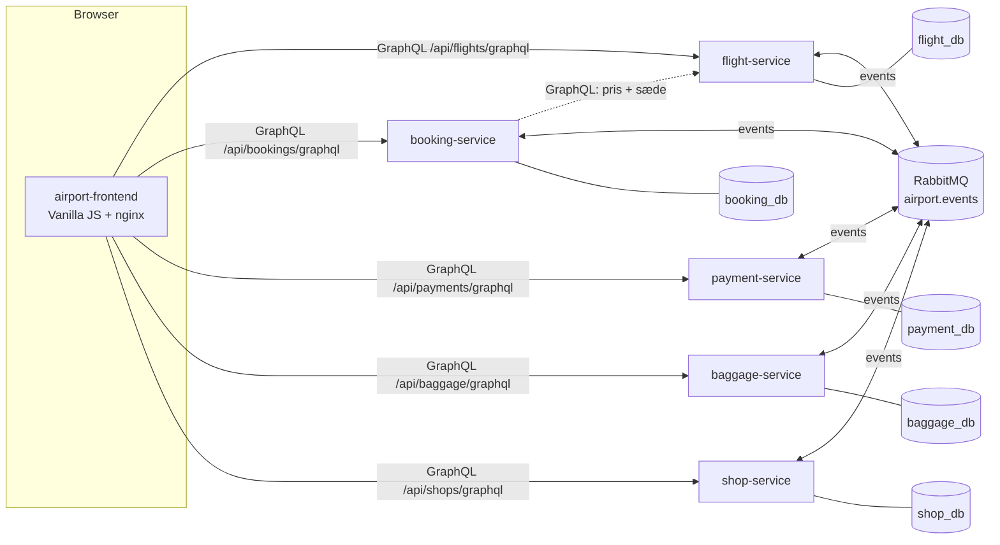
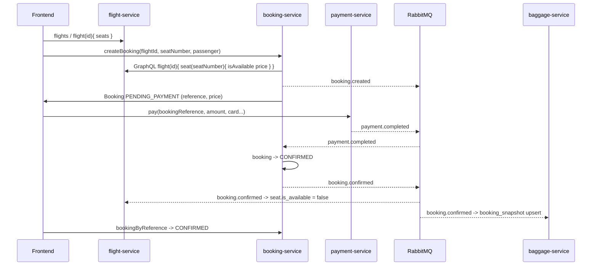
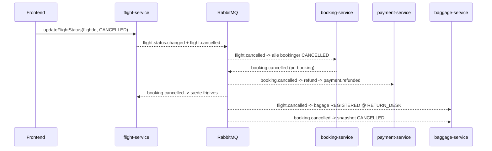
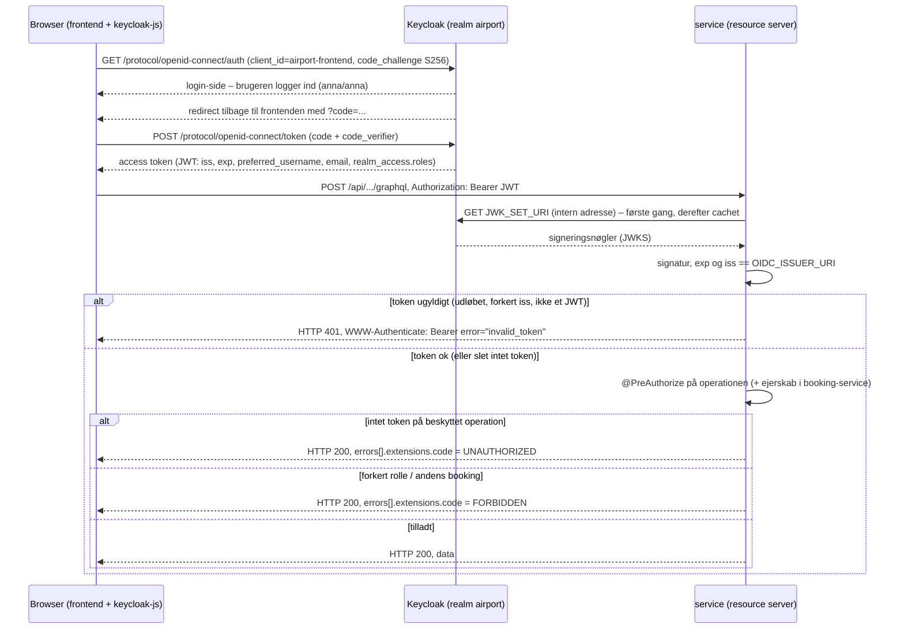

# Arkitektur

## Overblik



```
  [Frontend]  --GraphQL-->  [Flight Service]   ---> flight_db
              --GraphQL-->  [Booking Service]  ---> booking_db   --GraphQL--> Flight Service (pris/sæde)
              --GraphQL-->  [Payment Service]  ---> payment_db
              --GraphQL-->  [Baggage Service]  ---> baggage_db
              --GraphQL-->  [Shop Service]     ---> shop_db

  Alle backend-services <--events--> [RabbitMQ: topic exchange "airport.events"]
```

Regler der overholdes:

* Én PostgreSQL-database pr. service. Ingen service læser i en anden services database.
* Synkront: frontend → service via GraphQL over HTTP (Spring for GraphQL). Kun `/actuator/health` er REST.
* Asynkront: service → service via events på RabbitMQ (se [events.md](events.md)).
* Services cacher snapshots fra events (fx booking gemmer flightnummer, afgangstid, gate og flystatus;
  baggage gemmer `booking_snapshot`). Kilden til sandhed er altid den ejende service.
* Frontend kalder services direkte. I docker-compose via `localhost:808x` med CORS; i Kubernetes via
  én Ingress, hvor frontend og API deler origin.

## Teknologi pr. service

Alle fem backend-services er bygget over samme skabelon (flight-service var den første og de øvrige er
kopier af strukturen):

| Lag         | Pakke        | Indhold                                                                 |
|-------------|--------------|-------------------------------------------------------------------------|
| domain      | `.domain`    | JPA-entiteter, enums, `ApiException` + `ErrorCode`                      |
| repository  | `.repository`| Spring Data JPA repositories (+ Specifications hvor der filtreres)      |
| service     | `.service`   | Forretningslogik, transaktioner, ren domænelogik (pris, regler, Dijkstra) |
| graphql     | `.graphql`   | `@Controller` med `@QueryMapping`/`@MutationMapping`/`@SchemaMapping`, input-records med Bean Validation, `GraphQlExceptionResolver` |
| messaging   | `.messaging` | `EventEnvelope`, `EventPublisher` + `OutboxEvent`/`OutboxRelay` (transactional outbox), consumers + transaktionelle handlers, `ProcessedEvent` (idempotens) |
| config      | `.config`    | RabbitMQ-topologi (exchange, køer, DLQ), GraphQL-scalars, `SecurityConfig` + `KeycloakRoleConverter` (JWT, roller, CORS – se [Sikkerhed](#sikkerhed-login-og-roller)) |

Skema og seed-data styres af Flyway (`V1__init.sql`, `V2__seed.sql`, `V{n}__outbox.sql`); Hibernate kører med
`ddl-auto=validate`.

### GraphQL-fejl

Alle fejl returneres i `errors[].extensions.code` med en af koderne
`NOT_FOUND`, `VALIDATION_ERROR`, `INVALID_STATE`, `SEAT_TAKEN`, `UPSTREAM_UNAVAILABLE`, `ALREADY_PAID`,
`BAGGAGE_LIMIT_EXCEEDED`, `ROUTE_NOT_FOUND`, `CONFLICT`, `INTERNAL_ERROR`, `PAYMENT_FAILED`, `UNAUTHORIZED`, `FORBIDDEN`.

De to sikkerhedskoder (se [Sikkerhed](#sikkerhed-login-og-roller)):

| Kode           | `classification` | Svarer til | Hvornår                                                                                             |
|----------------|------------------|------------|-----------------------------------------------------------------------------------------------------|
| `UNAUTHORIZED` | `UNAUTHORIZED`   | HTTP 401   | Operationen kræver login, men kaldet havde intet Bearer-token (anonymt kald rammer `@PreAuthorize`)  |
| `FORBIDDEN`    | `FORBIDDEN`      | HTTP 403   | Logget ind, men rollen tillader ikke operationen (fx PASSENGER → `updateFlightStatus`), eller en PASSENGER rører en anden passagers booking |

GraphQL svarer som altid HTTP 200 med fejlen i `errors[]`, så klienten kan læse koden. Et token, der er udløbet,
har forkert `iss` eller ugyldig signatur, afvises derimod med en rigtig **HTTP 401** (`WWW-Authenticate: Bearer
error="invalid_token"`) allerede i Spring Securitys filterkæde, før GraphQL.
`PAYMENT_FAILED` er defineret, men kastes ikke: `pay` returnerer et `Payment` med `status: FAILED` og `failureReason`
i stedet for en GraphQL-fejl (se designvalg nedenfor).
Bean Validation-fejl (`ConstraintViolationException`) mappes til `VALIDATION_ERROR` med feltnavne i beskeden.

### Messaging

* Én topic exchange `airport.events`, routing key = eventnavn.
* Én durable kø pr. service pr. interesse (`<service>.<interesse>-events`), bundet med `<prefix>.#`.
* Retry: Spring AMQP stateless retry, 3 forsøg med eksponentiel backoff; derefter reject → dead-letter
  exchange `airport.events.dlx` → `<service>.dlq`.
* Idempotens: `processed_event(event_id)` skrives i samme transaktion som tilstandsændringen.
* Publicering går gennem en **transactional outbox**: `EventPublisher.publish` rører ikke RabbitMQ, men
  serialiserer envelopen og indsætter den i tabellen `outbox_event` i samme transaktion som
  tilstandsændringen. Tilstand og event committes derfor atomisk (eller rulles tilbage sammen), og
  `publish` fejler hårdt hvis den kaldes uden for en transaktion.
* `OutboxRelay` (`@Scheduled`, hvert 500 ms) sender rækkerne videre: den tager en Postgres advisory lock
  (`pg_try_advisory_xact_lock`), så kun ét relay er aktivt pr. service selv med flere replicas, læser de ældste
  usendte rækker (`ORDER BY id ... FOR UPDATE`), sender batchen med publisher confirms
  (`RabbitTemplate.invoke` + `waitForConfirmsOrDie`) og sætter først `published_at` når brokeren har
  bekræftet. Fejler sendingen (broker nede, nack, timeout) tælles `attempts` op, `last_error` gemmes, og
  rækkerne bliver liggende til næste poll. Backloggen ses som gauge `outbox.pending` (`/actuator/metrics`).
* Garanti: at-least-once fra producent + idempotent consumer (`processed_event`) = effektivt exactly-once.
  Dør relayet mellem bekræftelse og commit, sendes rækken igen med samme `eventId`, og modtageren
  ignorerer duplikatet. Rækkefølgen pr. producent bevares (ét aktivt relay, `ORDER BY id`, en fejlet batch
  gentages som helhed).
* Consumeren parser selv envelope-JSON (ingen `__TypeId__`-magi), så services kan have hver sin kopi af
  `EventEnvelope` uden delt bibliotek.

## Flows

### Flow A – Booking og betaling



1. Frontend henter afgange og sæder fra flight-service.
2. `createBooking` → booking-service validerer sædet og henter prisen synkront hos flight-service,
   gemmer booking i `PENDING_PAYMENT` og publicerer `booking.created`.
   Dobbeltbooking forhindres af et partielt unikt indeks på `(flight_id, seat_number) WHERE status <> 'CANCELLED'`
   → fejlkode `SEAT_TAKEN`.
3. `pay(...)` → payment-service simulerer gateway og publicerer `payment.completed` (eller `payment.failed`).
4. booking-service modtager `payment.completed` → `CONFIRMED` → publicerer `booking.confirmed`
   (`payment.failed` → `CANCELLED` → `booking.cancelled`).
5. flight-service markerer sædet optaget. 6. baggage-service opretter `booking_snapshot`.
7. Frontend poller `bookingByReference` og viser `CONFIRMED`.

### Flow B – Bagage

1. `registerBaggage(reference, 23, CHECKED)` → baggage-service tjekker `booking_snapshot.status ∈ {CONFIRMED, CHECKED_IN}`,
   max 3 CHECKED pr. booking og max 32 kg → tag `BAG-XXXXXXXX`, event `baggage.registered`.
2. `updateBaggageStatus(tag, LOADED, "Belt 4")` → event `baggage.status.changed`.
3. Frontend viser bagage under "Min booking" (`baggageByBooking`).

### Flow C – Aflysning



### Flow D – Navigation

1. Frontend vælger fra-node ("Security T2") og til-node ("Gate B12") blandt `navNodes`.
2. `route(fromNodeId, toNodeId, accessibleOnly)` → Dijkstra over `nav_edge` (kanterne behandles som
   tovejs; `accessibleOnly=true` udelader kanter med `accessible=false`, fx trapper).
3. Svaret indeholder trin-for-trin instruktioner, samlet afstand, estimeret gangtid (80 m/min) og
   `shopsAlongRoute` – butikker hvis node indgår i ruten. Frontend tegner gangnetværket og ruten på et SVG-kort med
   nummererede trin, instruktionstekst pr. trin, afstand pr. delstrækning og retningspile; trin på en anden etage vises som hint.

## Sikkerhed (login og roller)

Login og roller er lagt oven på systemet uden at ændre GraphQL-skemaerne: **Keycloak** er OpenID Connect-provider
(IdP), frontenden er OIDC-client (Authorization Code + PKCE), og de fem services er **OAuth2 resource servers**, der
validerer et Bearer-token (JWT) i hvert kald og autoriserer pr. operation med `@PreAuthorize`.

### Valg af identity provider

**Beslutning: Keycloak 26 i docker-compose og Kubernetes** med et realm, der importeres fra
`k8s/keycloak/realm-airport.json`.

| Mulighed | Vurdering |
|----------|-----------|
| **Keycloak (valgt)** | Giver realm-roller (`PASSENGER`, `OPERATIONS`) direkte i tokenet, kører offline i compose og kind, og realm-filen er én kilde til roller, client og testbrugere, så hver demo starter i kendt tilstand. Kan brokere til Google/GitHub (identity brokering), så 3.-parts login stadig er muligt – se [GitHub-login](#github-login-identity-brokering). |
| Google eller Microsoft (Entra ID) direkte fra frontenden | Ægte 3.-parts OIDC med `id_token`, men kræver netadgang, en registreret app og rigtige konti for hver tester, og giver ingen applikationsroller – dem skulle vi selv vedligeholde et andet sted. |
| GitHub alene | Duer ikke som IdP: GitHub er ren OAuth 2.0 og udsteder intet `id_token` (ingen OIDC). Bruges kun *bag* Keycloak. |
| Egen bruger-/kodeordstabel i en service | Egen kodeordshåndtering er præcis det, en IdP skal fjerne; ingen standardtokens. |

### Komponenter

* **Keycloak 26** (`quay.io/keycloak/keycloak:26.7.3`, `start-dev --import-realm`, H2 i containeren/en `emptyDir`).
  Realm'et `airport` importeres ved hver opstart fra `k8s/keycloak/realm-airport.json` – samme fil i compose (mount)
  og Kubernetes (ConfigMap `keycloak-realm` via `configMapGenerator`). Det definerer realm-rollerne `PASSENGER` og
  `OPERATIONS`, testbrugerne `anna`/`anna` (PASSENGER, `anna@example.com`) og `ops`/`ops` (OPERATIONS,
  `ops@example.com`) og den public client `airport-frontend`: Authorization Code + PKCE (S256), ingen client secret,
  redirect-URIs for `localhost:8080` (compose), `localhost:8090` (kind) og `airport.local`. Direct access grants er slået
  til, så `scripts/e2e-smoke.sh` og `curl` kan hente tokens med password grant. Access tokens lever 5 minutter og
  signeres med RS256. I compose på `http://localhost:8180`, i Kubernetes bag Ingress-stien `/auth`.
* **Frontend som OIDC-client** (`frontend/js/auth.js`): én instans af den vendorede `keycloak-js` 26.2.4
  (`js/vendor/keycloak.js` – Keycloak 26 serverer ikke længere adapteren selv). `initAuth()` kører før første render
  med `onLoad: 'check-sso'` og `silent-check-sso.html` i en skjult iframe, så en eksisterende session overlever en
  page refresh uden redirect. **Tokenet ligger kun i hukommelsen** (keycloak-js-instansen) – aldrig i
  `localStorage`/cookies – og fornyes af `getToken()`, når det udløber inden 30 s. `api.js` sætter
  `Authorization: Bearer <token>` på **alle** GraphQL-kald, når brugeren er logget ind. Siderne *Book*, *Betaling*,
  *Min booking* og *Bagage* sender brugeren til login før render (`LOGIN_REQUIRED` i `app.js`); operations-panelet
  under *Afgange* vises kun med `hasRole('OPERATIONS')`. Log ind/ud ligger i headeren.
* **Services som OAuth2 resource servers** – `config/SecurityConfig.java` og `config/KeycloakRoleConverter.java` er
  identiske i alle fem services (flight-service var skabelonen). Kæden er stateless (ingen sessioner, CSRF slået fra,
  ingen cookies); `oauth2ResourceServer().jwt()` validerer tokenet, og `KeycloakRoleConverter` oversætter
  `realm_access.roles` til `ROLE_<navn>`. `Authentication.getName()` er `preferred_username`. På HTTP-niveau er
  GraphQL-endpointet, `/actuator/health/**`, `/actuator/info` og `/graphiql` (kun dev) åbne; alle andre URL'er (fx
  `/actuator/metrics`) kræver OPERATIONS. Selve autorisationen ligger pr. operation som `@PreAuthorize` på
  controller-metoderne (`@EnableMethodSecurity`). CORS ligger i samme filterkæde (`CORS_ALLOWED_ORIGINS`), og fordi
  `CorsFilter` kører før autentificering, kræver preflight-requests aldrig et token.

### Login- og kaldsflow



Et request uden `Authorization`-header er anonymt: offentlige queries svarer som før, beskyttede operationer giver
`UNAUTHORIZED`, og frontenden sender så brugeren til login og tilbage til samme side.

### Hvad er offentligt?

**Beslutning:** læse-queries uden persondata er offentlige; alt, der viser eller ændrer en booking, en betaling eller
bagage, kræver login.

* **Offentligt:** afgange, flyselskaber og sæder (flight-service) og butikker, søgning, navigationsnetværk og rute
  (shop-service). Det er information, lufthavnen alligevel viser på skærme, og en passager skal kunne se afgange og
  finde vej uden at logge ind.
* **Kræver login:** alle queries i booking-, payment- og baggage-service (navn, e-mail, pasnummer, betalinger, bagage)
  og alle mutations i alle fem services.

Fordi samme `/graphql`-endpoint bærer både offentlige queries og beskyttede mutations, kan reglen ikke ligge på URL'en.
Den ligger derfor pr. operation (`@PreAuthorize`), og GraphQL-endpointet er åbent på HTTP-niveau.

### Operation × rolle

`@PreAuthorize` sidder på controller-metoderne (`graphql/<X>Controller.java`); `@SchemaMapping`-felter (fx
`Flight.seats`, `Passenger.bookings`) følger den query, de hentes igennem, og har ingen egen regel.

| Service         | Operation                                                                        | Type     | Hvem må kalde                                    |
|-----------------|----------------------------------------------------------------------------------|----------|--------------------------------------------------|
| flight-service  | `airlines`, `airline`, `flights`, `flight`, `flightByNumber`, `availableSeats`   | query    | Alle (også uden login)                           |
| flight-service  | `createAirline`, `createAircraft`, `createFlight`, `updateFlightStatus`, `updateGate` | mutation | OPERATIONS                                  |
| booking-service | `booking`, `bookingByReference`, `passenger`                                     | query    | PASSENGER (kun egne) / OPERATIONS (alle)         |
| booking-service | `bookingsByPassenger(email)`                                                     | query    | PASSENGER (kun egen e-mail) / OPERATIONS (alle)  |
| booking-service | `createBooking`                                                                  | mutation | PASSENGER (kun med egen e-mail) / OPERATIONS     |
| booking-service | `cancelBooking`, `checkIn`                                                       | mutation | PASSENGER (kun egne) / OPERATIONS (alle)         |
| payment-service | `paymentsByBooking`                                                              | query    | PASSENGER / OPERATIONS                           |
| payment-service | `payment(id)` (fortløbende id'er, kan gennemløbes)                               | query    | OPERATIONS                                       |
| payment-service | `pay`                                                                            | mutation | PASSENGER / OPERATIONS                           |
| payment-service | `refund`                                                                         | mutation | OPERATIONS                                       |
| baggage-service | `baggage`, `baggageByBooking`, `bookingSnapshot`                                 | query    | PASSENGER / OPERATIONS                           |
| baggage-service | `baggageByFlight`                                                                | query    | OPERATIONS                                       |
| baggage-service | `registerBaggage`                                                                | mutation | PASSENGER / OPERATIONS                           |
| baggage-service | `updateBaggageStatus`                                                            | mutation | OPERATIONS                                       |
| shop-service    | `shops`, `shop`, `searchShops`, `navNodes`, `navEdges`, `route`                  | query    | Alle (også uden login)                           |
| shop-service    | `createShop`, `updateShop`, `deleteShop`                                         | mutation | OPERATIONS                                       |

Uden for GraphQL: `/actuator/health`, `/actuator/health/**`, `/actuator/info` og GraphiQL (`/graphiql`, kun i
dev-profilen) er offentlige; øvrige actuator-endpoints kræver OPERATIONS.

### Ejerskab: "egen booking"

En passager identificeres allerede af sin e-mail (unikt indeks på `passenger.email`, se designvalg). Tokenet har
samme e-mail i `email`-claimet, så booking-service bruger den som ejerskab: en PASSENGER må kun booke med sin egen
e-mail og kun se, annullere og checke ind på bookinger, hvis passager har den e-mail (case-insensitivt) – ellers
`FORBIDDEN`. OPERATIONS må alt. Frontenden udfylder og låser e-mailfeltet på *Book* for en PASSENGER.

Kendt begrænsning: payment- og baggage-service kender ikke passagerens e-mail (de har kun bookingreferencen), så
`paymentsByBooking`, `pay`, `registerBaggage` og bagageopslagene kræver login og rolle, men tjekker ikke ejerskab –
bookingreferencen (6 tegn, ca. 10⁹ muligheder) fungerer dér som adgangsnøgle, som på et boardingkort. Et ejerskabstjek
ville kræve, at e-mailen kom med i `booking.*`-eventsene og blev gemt i begge services' snapshots.

### Konfiguration: issuer og JWKS

Hver service får to værdier (`application.yml` → `spring.security.oauth2.resourceserver.jwt`):

| Env-var           | Default (lokal udvikling)                                              | Betydning |
|-------------------|------------------------------------------------------------------------|-----------|
| `OIDC_ISSUER_URI` | `http://localhost:8180/realms/airport`                                 | Den streng, tokenets `iss` skal være lig med: Keycloaks *browser-vendte* URL + `/realms/airport` |
| `JWK_SET_URI`     | `http://localhost:8180/realms/airport/protocol/openid-connect/certs`  | Hvor servicen henter signeringsnøglerne: Keycloaks *interne* adresse i compose-netværket/clusteret |

| Miljø          | `OIDC_ISSUER_URI`                            | `JWK_SET_URI`                                                             |
|----------------|----------------------------------------------|---------------------------------------------------------------------------|
| docker-compose | `http://localhost:8180/realms/airport`       | `http://keycloak:8080/realms/airport/protocol/openid-connect/certs`       |
| kind           | `http://localhost:8090/auth/realms/airport`  | `http://keycloak:8080/auth/realms/airport/protocol/openid-connect/certs`  |

Når begge er sat, bruger Spring **aldrig** OIDC discovery: den henter nøglerne fra `jwk-set-uri` og sammenligner
`iss` med `issuer-uri` som ren streng. Derfor behøver en service aldrig at kunne nå browserens Keycloak-URL, og
browseren behøver ikke at kunne nå `keycloak:8080`. Faldgruben er, at Keycloak som udgangspunkt udleder `iss` af den
URL, forespørgslen kom ind på, så tokens hentet fra browseren og fra en container ville få to forskellige issuers.
Løsningen er `KC_HOSTNAME` (compose `http://localhost:8180`, kind `http://localhost:8090/auth`), som låser alle URL'er
Keycloak udgiver. Skifter man host eller port (fx minikube), skal `KC_HOSTNAME`, `OIDC_ISSUER_URI` i
`k8s/services/*.yaml` og `KEYCLOAK_URL` i frontendens ConfigMap rettes sammen; symptomet ellers er HTTP 401 med
`The iss claim is not valid`. Se [k8s/README.md, Keycloak (login)](../k8s/README.md#keycloak-login).

### GitHub-login (identity brokering)

Realm'et definerer en identity provider `github`, som er **slået fra** og har placeholder client id/secret i
`realm-airport.json`. En mapper giver alle brokerede brugere rollen PASSENGER, og e-mailen hentes med scope
`user:email`. Sådan tændes den:

1. Opret en OAuth App på GitHub (*Settings → Developer settings → OAuth Apps*) med *Authorization callback URL*
   `<KEYCLOAK_URL>/realms/airport/broker/github/endpoint` (compose:
   `http://localhost:8180/realms/airport/broker/github/endpoint`).
2. Keycloaks admin console (`admin`/`admin`, compose `http://localhost:8180/admin/`) → realm `airport` →
   *Identity providers* → *GitHub* → indsæt Client ID og Client Secret → *Enabled* → *Save*.
3. Login-siden viser nu en *GitHub*-knap; første login opretter brugeren med rollen PASSENGER.

Realm'et importeres forfra ved hver genstart (H2 i dev-mode), så indstillingen forsvinder igen – client secret skal
ikke committes.

### Fejl og frontendens reaktion

| Svar                                              | Hvornår                                                                     | Frontend (`api.js`)                                  |
|---------------------------------------------------|-----------------------------------------------------------------------------|------------------------------------------------------|
| GraphQL-fejl `UNAUTHORIZED` (HTTP 200)            | Beskyttet operation uden Bearer-token                                       | `login()`: til Keycloak og tilbage til samme side; "Log ind for at fortsætte" |
| GraphQL-fejl `FORBIDDEN` (HTTP 200)               | Logget ind, men forkert rolle eller en anden passagers booking              | Dansk besked "<bruger> har ikke rettighed til denne handling"; ingen redirect |
| HTTP 401, `WWW-Authenticate: Bearer error="invalid_token"` | Tokenet afvist før GraphQL: udløbet, forkert `iss`, ugyldig signatur | `login()` + "Din session er udløbet - log ind igen" |

`GraphQlExceptionResolver` skelner mellem de to GraphQL-koder ved at se på `SecurityContext`: en
`AccessDeniedException` fra `@PreAuthorize` bliver `UNAUTHORIZED`, hvis kalderen er anonym, ellers `FORBIDDEN`.

### Secrets i repoet er dev-værdier

Alle hemmeligheder i repoet er **dev-værdier** til lokal kørsel og demo og skal udskiftes før et delt miljø:
Keycloaks bootstrap-admin `admin`/`admin` (compose og `keycloak-secret`), testbrugerne `anna`/`anna` og `ops`/`ops`
(realm-filen), databasernes og RabbitMQ's brugere (compose og `k8s/**/secret.yaml`) og pgAdmins Secret. Klienten
`airport-frontend` er public og har bevidst ingen client secret (PKCE beskytter code-flowet), og GitHub-identity
providerens client id/secret står kun som placeholders. Services har ingen hemmeligheder til tokenvalidering – de
henter Keycloaks *offentlige* nøgler fra JWKS. I et rigtigt miljø: Keycloak med `start` (production mode), PostgreSQL
og TLS, rigtige kodeord i Secrets (eller en secret manager), password grant slået fra og testbrugerne fjernet.

### Test

Hver service har en `TestTokens`-klasse (test scope), der genererer en RSA-nøgle, minter RS256-JWT'er med samme
claims som Keycloak (`iss`, `preferred_username`, `email`, `realm_access.roles`) og erstatter `JwtDecoder` med en,
der stoler på testnøglen. Alt andet – Bearer-header, issuer-tjek, rolle-mapping, `@PreAuthorize`, CORS – kører som
i drift, så testene går gennem den rigtige HTTP-filterkæde uden en kørende Keycloak. `SecurityIntegrationTest` i hver
service dækker: uden token → `UNAUTHORIZED` (401), PASSENGER på en OPERATIONS-operation → `FORBIDDEN` (403), gyldigt
token med rigtig rolle → data (200), udløbet/fremmed/ugyldigt token → HTTP 401 med `invalid_token`, readiness uden
token, CORS-preflight og (booking-service) ejerskab af bookinger. `scripts/e2e-smoke.sh` henter tokens for `anna` og
`ops` fra Keycloak og tester det samme mod den kørende stak.

## Designmønstre

### Tombstone og snapshot (immutable data)

Fælles regel: **domænedata slettes aldrig fysisk.** Ingen service kalder `DELETE` på sine forretningstabeller; det
eneste fysiske `DELETE` er oprydningen af allerede sendte rækker i `outbox_event` efter 7 dage, som er transportdata og
ikke domænedata. Data, der "forsvinder", får i stedet en **tombstone**, og data, en service låner fra en anden, gemmes
som et **snapshot**.

**Tombstones som tilstand – booking, betaling og bagage.** Bookinger, betalinger og bagage slettes aldrig; at de
ophører, er en tilstand på rækken:

| Service | Tabel | "Slettet" betyder | Udløses af |
|---------|-------|-------------------|------------|
| booking-service | `booking` | `status = CANCELLED` (+ årsag i `booking.cancelled`) | `cancelBooking`, `payment.failed`, `flight.cancelled` |
| payment-service | `payment` | `status = REFUNDED` | `refund`, `booking.cancelled` |
| baggage-service | `baggage` / `booking_snapshot` | bagage sendes til `RETURN_DESK`; snapshottet får `status = CANCELLED` | `flight.cancelled`, `booking.cancelled` |
| flight-service | `flight` | `status = CANCELLED` (kan ikke ændres bagefter) | `updateFlightStatus` |

Fordi rækken bliver liggende, kan alle spørgsmål om historikken besvares bagefter ("hvorfor blev min booking
annulleret?"), og en aflyst booking i baggage-service giver `INVALID_STATE` i stedet for `NOT_FOUND`.

**Tombstone som tidsstempel – `deleteShop` i shop-service.** Butikker er det eneste, API'et kan "slette". En slettet
butik får et tidsstempel i stedet for at blive fjernet:

| Del | Hvad |
|-----|------|
| Migration `V4__shop_tombstone.sql` | Kolonnen `deleted_at TIMESTAMPTZ` (NULL = aktiv); de fulde indekser på `terminal`, `category` og `node_id` er erstattet af partielle indekser `WHERE deleted_at IS NULL`, så gravstenene aldrig gør opslagene på aktive butikker langsommere |
| `Shop` (entity) | `@SQLRestriction("deleted_at IS NULL")`: Hibernate tilføjer betingelsen til *alle* queries på entiteten – `findById`, `findAll`, specifications og JPQL (`searchShops`) – så ingen repository-metode skal huske et filter |
| `ShopService.deleteShop` | `shop.markDeleted(now)` i transaktionen. Bagefter er `shop(id)` null, butikken er væk fra `shops`, `searchShops`, `NavNode.shops` og `shopsAlongRoute` på Dijkstra-ruter, og `updateShop`/`deleteShop` giver `NOT_FOUND` |
| Test | `ShopServiceIntegrationTest.deletedShopLeavesATombstoneThatNoQuerySees`: butikken ses på en rute før sletning og ingen steder efter, men rækken findes stadig med `deleted_at` sat (læst med `JdbcTemplate` uden om Hibernate) |

Hvorfor: en fysisk `DELETE` kan ikke fortrydes (`UPDATE shop SET deleted_at = NULL WHERE id = …` gendanner en
butik), historikken bevares, og et id, der er nævnt i en log eller et event, peger aldrig ud i ingenting. Prisen er,
at tabellen vokser, og at et nyt unikhedskrav (fx unikt navn) skal være et partielt unikt indeks på aktive rækker.
Fravalgt: Hibernates `@SoftDelete` gemmer kun en boolean, ikke *hvornår* rækken blev slettet. shop-service publicerer
ingen shop-events, og ingen anden service har en kopi af butikkerne, så der er ingen tombstone-*besked* på bussen.

**Snapshots – værdier frosset på handlingstidspunktet.** Hvor en service har brug for en anden services data, kopierer
den værdien ind i sin egen række, når handlingen sker, i stedet for at slå den op igen senere:

| Service | Snapshot | Kopieret fra | Hvorfor |
|---------|----------|--------------|---------|
| booking-service | `booking.price`, `flight_number`, `departure_time` (og `currency`) | flight-service (`createBooking` slår sæde og pris op synkront) | Prisen, passageren har accepteret, må ikke ændre sig, hvis flyets `basePrice` ændres bagefter; bookingen kan vises uden kald til flight-service |
| baggage-service | `baggage.passenger_name`, `flight_number` | baggage-services `booking_snapshot` ved `registerBaggage` | Tagget og bagagelisten viser navn og fly, som de var ved indtjekning |
| payment-service | `payment.amount`, `card_last4` | klientens `pay`-kald (bookingens pris) | Det trukne beløb står fast, også ved refundering; kortnummeret gemmes ikke, kun de sidste fire cifre |

**Snapshots – lokale kopier, der holdes opdateret af events.** Enkelte felter er bevidst *ikke* frosset, fordi de
skal følge kilden:

| Service | Kopi | Opdateres af | Bruges til |
|---------|------|--------------|------------|
| booking-service | `booking.gate`, `flight_status` | `flight.status.changed`, `flight.gate.changed`, `flight.cancelled` | *Min booking* viser aktuel gate og flystatus uden kald til flight-service |
| baggage-service | tabellen `booking_snapshot` (reference, passagernavn, fly, status) | `booking.created/confirmed/checkedin/cancelled`, `flight.cancelled` | `registerBaggage` kræver status `CONFIRMED`/`CHECKED_IN` – også når booking-service er nede |

Kopierne er *eventually consistent* (typisk under et sekund), og kilden til sandhed er altid den ejende service.
Handlerne er idempotente (`processed_event`), så et dubleret event ikke ændrer kopien to gange.

### Idempotens: hvad sker der, når en mutation gentages?

Brugere dobbeltklikker, browsere gentager et request, når svaret går tabt, og RabbitMQ leverer events at-least-once.
Hver skrivende operation har derfor en defineret opførsel ved gentagelse – via en naturlig nøgle, en tilstandsregel
eller en eksplicit idempotency key fra klienten:

| Service | Mutation | Hvad gør den idempotent | Gentagelse giver |
|---------|----------|-------------------------|------------------|
| baggage-service | `registerBaggage` | **Idempotency key** fra klienten (argument `idempotencyKey`); kolonnen `baggage.idempotency_key` er `UNIQUE` (`V3__baggage_idempotency.sql`) | Den bagage, første kald registrerede – intet nyt INSERT og intet nyt `baggage.registered`. Samme nøgle med anden booking/vægt/type → `CONFLICT` |
| baggage-service | `updateBaggageStatus` | Tilstand: samme status og samme (eller ingen) lokation er en no-op | Uændret bagage, intet ekstra `baggage.status.changed` |
| shop-service | `createShop` | **Idempotency key** (`idempotencyKey`, `shop.idempotency_key UNIQUE`, `V5__shop_idempotency.sql`) | Samme butik; er butikken siden slettet (tombstone), er nøglen stadig optaget → `CONFLICT` |
| shop-service | `updateShop` | Naturligt idempotent: hele butikken overskrives (PUT-semantik) | Samme resultat |
| shop-service | `deleteShop` | Tombstone | Andet kald → `NOT_FOUND`; butikken er slettet én gang |
| booking-service | `createBooking` | Naturlig nøgle: partielt unikt indeks `ux_booking_active_seat (flight_id, seat_number) WHERE status <> 'CANCELLED'` | `SEAT_TAKEN` – sædet er allerede booket (af første kald) |
| booking-service | `cancelBooking`, `checkIn` | Tilstandsmaskine | `INVALID_STATE` (allerede aflyst / allerede checket ind); intet nyt event |
| payment-service | `pay` | Tilstand: findes der en `COMPLETED` betaling for referencen? | `ALREADY_PAID` – kortet trækkes ikke to gange |
| payment-service | `refund` | Tilstand: kun `COMPLETED` kan refunderes | `INVALID_STATE`; ingen dobbelt refundering |
| flight-service | `createAirline`, `createAircraft`, `createFlight` | Naturlige nøgler: `iata_code`, `registration`, `(flight_number, scheduled_departure)` er `UNIQUE` | `CONFLICT` |
| flight-service | `updateFlightStatus`, `updateGate` | Tilstand: samme status/gate er en no-op | Intet nyt event (en aflyst flight kan ikke ændres: `INVALID_STATE`) |
| alle consumers | indgående events | `processed_event` med `eventId` som primærnøgle i samme transaktion som ændringen | Duplikatet ignoreres (se *Messaging*) |

**Idempotency key – hvordan og hvorfor.** Nøglen identificerer *én tilsigtet skrivning*, ikke en ressource.
Frontenden (`frontend/js/pages/baggage.js`) laver en nøgle med `newIdempotencyKey()` (UUID v4 via
`crypto.randomUUID()`, og via `crypto.getRandomValues()` over ren http, hvor `randomUUID` ikke findes), sender den
uændret ved hver gentagelse af samme formular og laver en ny, når formularen ændres, eller når en bagage er
registreret. `BaggageService.register` slår nøglen op, før der skrives; to samtidige kald med samme nøgle afgøres af
`UNIQUE`-constrainten – taberens transaktion rulles tilbage, og opslaget gentages i en ny transaktion, hvor den finder
vinderens bagage (derfor er metoden bevidst ikke én transaktion). `createShop` bruges ikke fra frontenden; en klient
(fx et script) sender selv nøglen. Uden nøgle opfører begge mutations sig som før, så eksisterende klienter ikke
brækker. Testet i `BaggageServiceIntegrationTest.registrationWithTheSameIdempotencyKeyIsReplayedNotRepeated` og
`ShopServiceIntegrationTest.createShopWithTheSameIdempotencyKeyCreatesOneShop` (to kald med samme nøgle → én række).
Fravalgt: at lade serveren udlede "samme request" af indholdet (fx booking + vægt + type inden for et minut) – to ens
kufferter på samme booking er en helt legitim situation, som kun klienten kan skelne fra et dobbeltklik.

## Designvalg (hvor spec'en gav frihed)

| Emne | Valg | Begrundelse |
|------|------|-------------|
| Pris i booking-service | Synkront GraphQL-kald til flight-service (`RestClient`) ved `createBooking` | Enkelt, altid korrekt pris og sædestatus; ingen kopi af sædedata i booking_db |
| Booking-snapshot | `booking` har ekstra kolonner `gate`, `flight_status`, `currency` | `flight.status.changed`/`flight.gate.changed` har noget at opdatere; vises under "Min booking" |
| Passager | Nøgle = e-mail (case-insensitivt unikt indeks); navn/pas opdateres ved ny booking | Enkel identitet; samme e-mail står i Keycloak-tokenet og bruges som ejerskab (se [Ejerskab](#ejerskab-egen-booking)) |
| Bookingreference | 6 tegn fra `ABCDEFGHJKLMNPQRSTUVWXYZ23456789` (uden 0/O/1/I), op til 5 forsøg ved kollision | Læsbar og entydig |
| Annullering | Tilladt fra PENDING_PAYMENT, CONFIRMED og CHECKED_IN; `payment.failed` giver årsag "Payment failed: <reason>" | Spec forbyder ikke annullering efter check-in |
| Sædepris | `basePrice` på flight × klassemultiplikator (ECONOMY 1.0, BUSINESS 2.5, FIRST 4.0) | Spec'ens seat-tabel har ingen pris; dette holder prisen i flight-service |
| Sædelayout | Rækker á 6 (A–F), række 1–2 BUSINESS | Deterministisk, samme regel i SQL-seed og `SeatGenerator` |
| Fælles event-envelope | Identisk record kopieret ind i hver service | Ingen delt Maven-modul → hver service bygger uafhængigt med én Dockerfile |
| Event-publicering | Transactional outbox (`outbox_event`) med polling relay, publisher confirms og advisory lock | Dual-write-problemet: en channel-transacted `RabbitTemplate` sender beskeden i en separat AMQP-transaktion, der committes *efter* DB-commit, så et event kan gå tabt imellem de to (broker-genstart, tabt forbindelse, pod dræbt) – og i consumer-handlers maskeres tabet af `processed_event`, fordi det indgående event er registreret som behandlet. Med outboxen er DB-commit den eneste sandhed; relayet leverer at-least-once, og `processed_event` fjerner duplikater |
| Topic-binding | `<prefix>.#` | `*` matcher kun ét segment; `flight.status.changed` har tre |
| GraphQL-path | Hver service serverer på `/api/<x>/graphql` (`GRAPHQL_PATH`) | Samme path lokalt og bag Ingress → ingen rewrite-regler |
| Fejlet betaling | `pay` returnerer `Payment` med `status: FAILED` og `failureReason` | Frontend kan vise årsagen; booking annulleres asynkront via `payment.failed` |
| Betalingsvalidering | Scalar-argumenterne samles i `PayInput` og valideres med en injiceret `Validator` | Feltnavne i fejlbeskeden; spec'ens signatur `pay(bookingReference, amount, ...)` bevares |
| Udløbsdato | `MM/YY` og `MM/YYYY`; kortet gælder til månedens sidste dag; "Card expired" vinder over "0000" | Enkel, forudsigelig simuleringsregel |
| Payment kender ikke bookingen | payment-service har intet booking-snapshot; `ALREADY_PAID` forhindrer dobbeltbetaling af samme reference | Spec kræver kun lytning på `booking.cancelled`; beløbet kommer fra frontenden (bookingens pris) |
| Bagage-snapshot | `booking_snapshot` har ekstra kolonne `flight_id`; `booking.created` gemmes også (PENDING_PAYMENT) | `flight.cancelled` kan matche på id og nummer; ubetalt booking giver `INVALID_STATE` frem for `NOT_FOUND` |
| Bagage-lokation | Registrering sætter `last_location=CHECK_IN`; aflyst fly → `RETURN_DESK` (bagage der er ARRIVED/LOST springes over) | Spec kræver kun RETURN_DESK; CHECK_IN giver en meningsfuld startværdi |
| Navigationsgraf | `nav_edge` gemmes én gang og behandles som tovejs; `accessibleOnly` udelader `accessible=false` (trapper) | Halvt så mange rækker, samme resultat |
| Ruteinstruktioner | Dansk: "Start ved …", "Gå N m til …", "Tag elevatoren/trappen til etage N", "Du er fremme ved …"; gangtid 80 m/min | Tekstbaseret rute som spec'en kræver |
| Åbningstider | `HH:MM-HH:MM` (også over midnat) eller `24/7`, evalueret i `APP_TIMEZONE` (Europe/Copenhagen) | Enkelt format i seed-data |
| Ekstra query | `navEdges(terminal)` i shop-service | Frontenden tegner gangnetværket (kanterne) på SVG-kortet; kanter med `accessible=false` stiples |
| Postgres | 5 separate containere / StatefulSets | Afspejler Kubernetes-opsætningen og "én database pr. service" |
| pgAdmin i Kubernetes | Dev/demo-værktøj i `k8s/tools/` uden login (desktop mode); **ikke** i standardstakken – tilvælges med `kubectl apply -k k8s/tools/` og har sin egen Ingress på `/pgadmin`; de fem databaser forudregistreret (ConfigMap) med kodeord fra en pgpass-fil (Secret) | Viser "én database pr. service" og eventflowet live i en demo; fordi den ikke har login, må den ikke ligge i den stak, der deployes som standard |
| Strukturerede logs | Spring Boots indbyggede `logging.structured.format.console=logstash` i `prod`-profil | Ingen ekstra dependency |
| Ubetalte bookinger | Forbliver `PENDING_PAYMENT` (ingen timeout) | Ikke krævet; kendt begrænsning – sædet er reserveret i booking_db men vises ledigt i flight-service indtil betaling |
