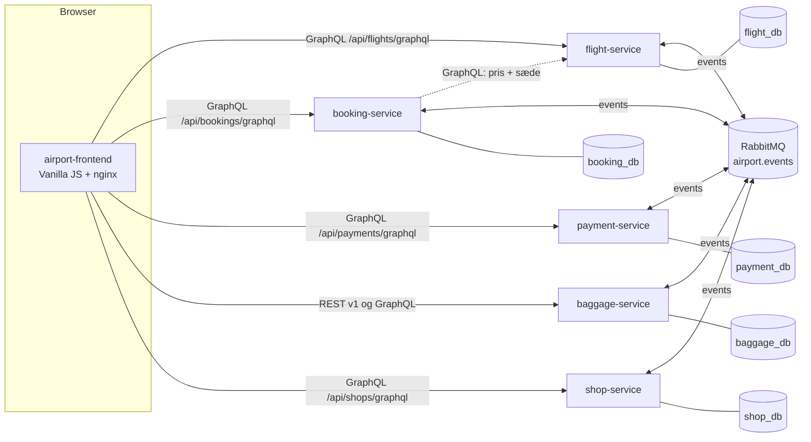
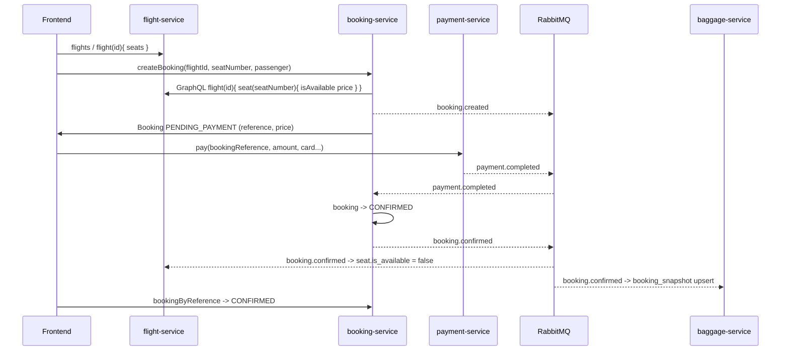
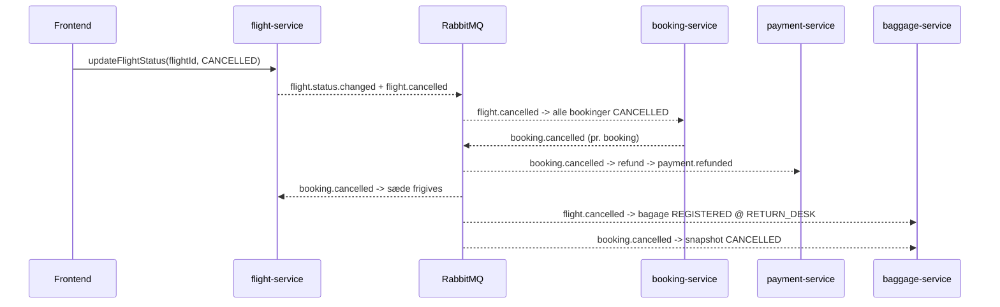
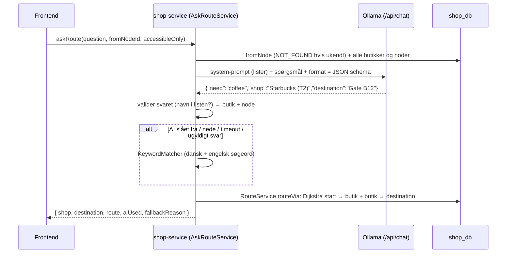
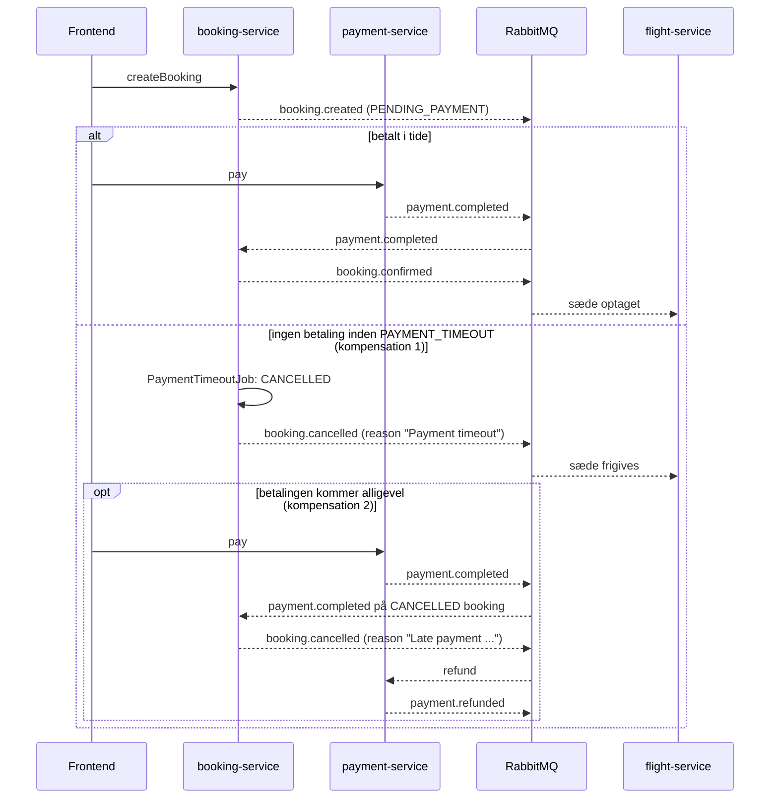
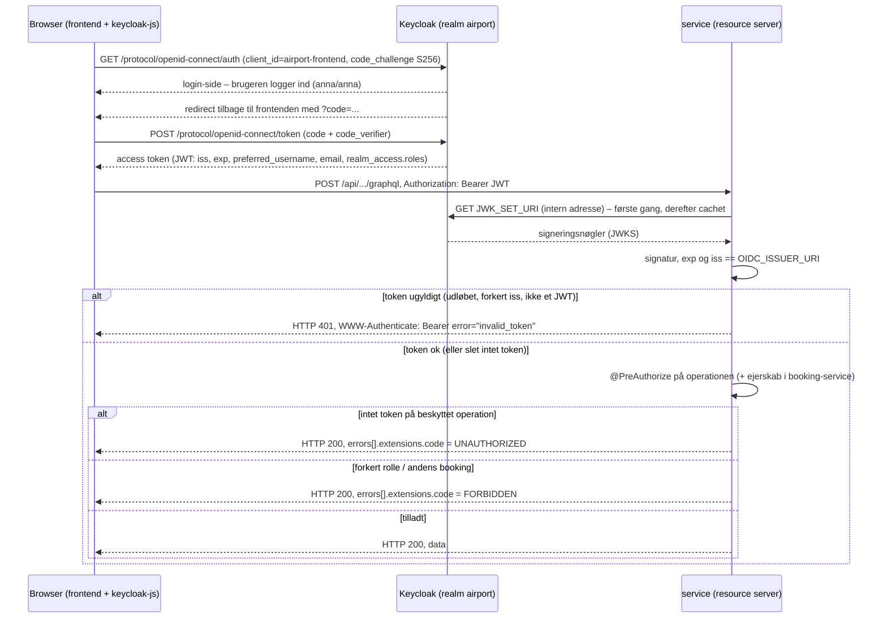
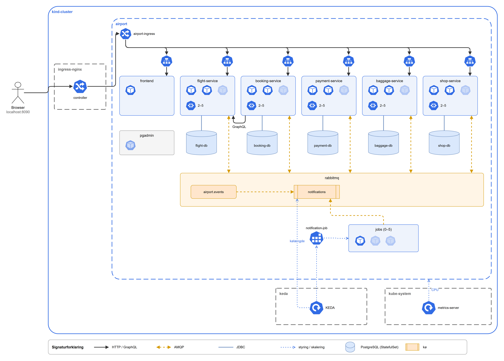
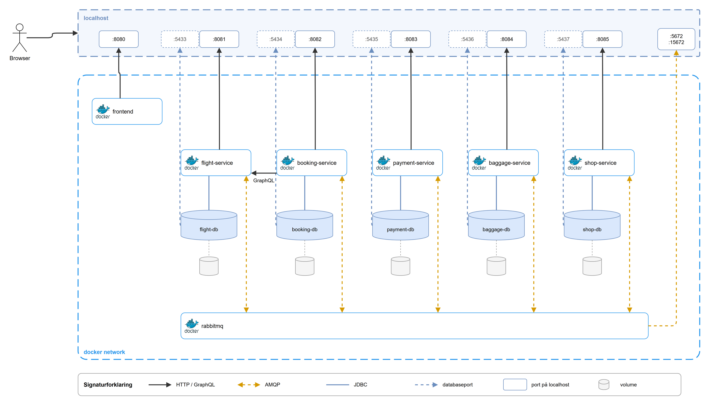

# Arkitektur

## Overblik



```
  [Frontend]  --GraphQL-->  [Flight Service]   ---> flight_db
              --GraphQL-->  [Booking Service]  ---> booking_db   --GraphQL--> Flight Service (pris/sæde)
              --GraphQL-->  [Payment Service]  ---> payment_db
              --REST/GraphQL--> [Baggage Service]  ---> baggage_db
              --GraphQL-->  [Shop Service]     ---> shop_db

  Alle backend-services <--events--> [RabbitMQ: topic exchange "airport.events"]
```

Regler der overholdes:

* Én PostgreSQL-database pr. service. Ingen service læser i en anden services database.
* Synkront: frontend → service via GraphQL over HTTP (Spring for GraphQL) og REST v1 for bagage.
* Asynkront: service → service via events på RabbitMQ (se [events.md](events.md)).
* Services cacher snapshots fra events (fx booking gemmer flightnummer, afgangstid, gate og flystatus;
  baggage gemmer `booking_snapshot`). Kilden til sandhed er altid den ejende service.
* Frontend kalder services direkte. I docker-compose via `localhost:808x` med CORS; i Kubernetes via
  én Ingress, hvor frontend og API deler origin.

## Teknologi pr. service

Alle fem backend-services er bygget over samme skabelon (flight-service var den første og de øvrige er
kopier af strukturen):

| Lag         | Pakke        | Indhold                                                                 |
|-------------|--------------|-------------------------------------------------------------------------|
| domain      | `.domain`    | JPA-entiteter, enums, `ApiException` + `ErrorCode`                      |
| repository  | `.repository`| Spring Data JPA repositories (+ Specifications hvor der filtreres)      |
| service     | `.service`   | Forretningslogik, transaktioner, ren domænelogik (pris, regler, Dijkstra) |
| graphql     | `.graphql`   | `@Controller` med `@QueryMapping`/`@MutationMapping`/`@SchemaMapping`, input-records med Bean Validation, `GraphQlExceptionResolver` |
| messaging   | `.messaging` | `EventEnvelope`, `EventPublisher` + `OutboxEvent`/`OutboxRelay` (transactional outbox), consumers + transaktionelle handlers, `ProcessedEvent` (idempotens) |
| config      | `.config`    | RabbitMQ-topologi (exchange, køer, DLQ), GraphQL-scalars, `SecurityConfig` + `KeycloakRoleConverter` (JWT, roller, CORS – se [Sikkerhed](#sikkerhed-login-og-roller)) |

Skema og seed-data styres af Flyway (`V1__init.sql`, `V2__seed.sql`, `V{n}__outbox.sql`); Hibernate kører med
`ddl-auto=validate`.

### API-versionering

REST-kontrakten har major-versionen i stien `/api/baggage/v1`. Bagudkompatible tilføjelser, fx et valgfrit felt,
kan leveres i v1. En breaking change, fx et omdøbt eller fjernet svarfelt, får en ny sti under
`/api/baggage/v2`. v1 kører parallelt, mens klienterne migrerer. `/api/baggage/v3/api-docs` er stien til
OpenAPI-dokumentet. Forretnings-API'ets version fremgår af de dokumenterede operationer.

GraphQL beholder sin eksisterende endpoint-sti. Skemaet får nye felter eller operationer, og en forgænger
markeres med `@deprecated(reason: "...")` med en henvisning til erstatningen.

REST og GraphQL kalder begge `BaggageService` og bruger samme data, regler og fejlkoder. REST sender
koden som `code` i `application/problem+json` med en HTTP-status, fx `400` for `VALIDATION_ERROR`,
`404` for `NOT_FOUND` og `409` for `INVALID_STATE`, `BAGGAGE_LIMIT_EXCEEDED` og `CONFLICT`.
Keycloak-rollerne er fælles. API'erne kan bruges på den samme bookingreference og det samme bagagetag.

### CQRS i booking-service

**Min booking** er en læsetung visning. Før skulle klienten hente booking, betalinger og bagage fra tre
services. Nu beder den kun booking-service om `bookingOverview(reference)`. Queryen læser én række i
`booking_overview` via bookingreferencen. Rækken indeholder booking og passager, senest observerede
betalingsstatus, antal unikke bagagetags og de betalings- og bagagelinjer, som siden viser.

`BookingCommandService` håndterer kommandoer og domæneændringer. `BookingQueryService` håndterer læsninger.
Den almindelige booking-API har stadig sine queries, og de øvrige sider kan fortsat bruge service-API'erne.
GraphQL-opslaget kræver login. En passager har adgang til egne oversigter, og `OPERATIONS` kan slå flere op.

- Bookingændringer kopieres til projektionen i samme databasetransaktion som kommandoen.
- `payment.completed`, `payment.failed`, `payment.refunded`, `baggage.registered` og `baggage.status.changed`
  opdaterer projektionen via RabbitMQ. Behandlede event-id'er registreres i samme transaktion som ændringerne.
  Betalinger identificeres med betalings-id og bagage med tag. En statusændring øger derfor ikke bagagetallet for et kendt tag.
- Betalings- og bagageoplysninger er eventual consistent. Siden kan kortvarigt vise en ældre status, mens events er på vej.
  Flyway fylder eksisterende bookinger og passagerer fra bookingdatabasen. Historiske betalings- og bagagelinjer
  kræver genafspilning af events fra deres kildeservices for at blive vist fuldt ud.

Læsemodellen er afledte data. Det gør det muligt at flytte eller replikere den og skalere læsninger uafhængigt
af kommandoerne senere. I den nuværende deployment bruger begge sider samme PostgreSQL-database i booking-service.

### Logging og monitoring

Alle fem backendservices skriver JSON-logs i Compose og Kubernetes. Micrometer Tracing med OpenTelemetry
sætter `traceId` og `spanId` i logkonteksten for HTTP-requests og RabbitMQ-events. Frontenden bruger samme
W3C-trace til oprettelse, betaling og bagageregistrering for en booking i samme browsersession. Hvert kald
har sit eget span. Booking-service bruger Spring Boots instrumenterede `RestClient.Builder`, så opslag
på sædet i flight-service også får trace-konteksten.

En outbox-række gemmer `traceparent` sammen med eventet. Den planlagte relay sender den gemte header på
RabbitMQ, også ved retries. Lytterens Micrometer-observation genoptager samme trace, og events, som
modtageren producerer, får den videre med i deres outbox. Logs uden en aktiv eller gemt sporingskontekst,
fx opstartslogs, har ingen trace-id. Der eksporteres ingen spans til en separat trace-backend.

Prometheus scraper `/actuator/prometheus` på alle fem services og RabbitMQs køspecifikke metrics på
`/metrics/detailed?family=queue_coarse_metrics`. Grafana-dashboardet **Airport** samler følgende målinger.

- `max by (application) (outbox_pending)` for events, der venter på brokerens bekræftelse. Maksimum undgår
  at tælle samme outbox flere gange, når en service har flere replikaer.
- DLQ-dybde pr. kø fra RabbitMQs `rabbitmq_detailed_queue_messages`.
- HTTP-latens som p95 pr. service fra request-histogrammer, eksklusive Actuator-kald.
- JVM-heap pr. service og status for Prometheus-scrapet.

Alloy sender podlogs i `airport`-namespacet til Loki. Compose-udgaven bruger Docker-daemonens socket til at
læse projektets containerlogs. Loki bevarer loglinjen og indekserer app som label. Trace-id søges i
JSON-feltet, så hver trace kan findes uden at danne en separat logstrøm.

#### Event-metrics og alarmer

`events_published_total` tæller beskeder, som RabbitMQ har bekræftet. `events_consumed_total` grupperer
behandlingsforsøg efter service, eventtype og udfald (`processed`, `duplicate` eller `failed`). Hvert
fejlet forsøg tælles, også når et senere retry lykkes. Ukendte eventtyper samles under `unknown`.

Grafana viser også eventrater, fejlede forsøg, CPU og aktive alarmer. Prometheus bruger samme regelfil i
Compose og Kubernetes. Alarmerne kan ses på [Prometheus Alerts](http://localhost:9090/alerts) i Compose.

| Alarm | Udløses ved |
|---|---|
| `ServiceDown` | En service kan ikke scrapes i 1 minut |
| `OutboxBacklog` | Mere end 20 ventende events i samme service i 2 minutter |
| `MessagesDeadLettered` | Beskeder i en DLQ i 1 minut |
| `EventHandlingFailing` | Fejlede eventforsøg inden for det seneste 5-minutters vindue i 2 minutter |
| `HighServerErrorRate` | Over 5 % HTTP-svar med 5xx i 5 minutter |

#### Find en fejl fra booking til bagage

1. Åbn Grafana **Explore**, vælg **Loki**, og find bookingreferencen med
   `{app="booking-service"} |= "BOOKINGREF"`. Åbn en relevant linje, og kopier `traceId`.
2. Søg på ID'et i dashboardets trace-felt eller i Explore med
   `{app=~".+-service"} | json | traceId = "TRACE_ID"`. Du kan følge bookingen, sædet i flight-service,
   betalingen og bagagen i tidsrækkefølge. Brug `eventId` til at sammenligne den samme RabbitMQ-besked på tværs
   af relay og modtager.
3. Stiger outbox, så tjek relayets publish-fejl og RabbitMQ. Stiger en DLQ, så tjek modtagerens fejl for det
   pågældende event. Brug p95 og JVM-heap til at se, om en enkelt service har langsomme requests eller høj hukommelsesbrug.

Fra Git Bash kan du køre `TRACE_BOOKING=1 bash scripts/e2e-smoke.sh` mod en opdateret Compose-stak.
Scriptet opretter og betaler en booking, registrerer bagage og kontrollerer samme trace-id i JSON-logs fra
booking-, flight-, payment- og baggage-service.

### GraphQL-fejl

Alle fejl returneres i `errors[].extensions.code` med en af koderne
`NOT_FOUND`, `VALIDATION_ERROR`, `INVALID_STATE`, `SEAT_TAKEN`, `UPSTREAM_UNAVAILABLE`, `ALREADY_PAID`,
`BAGGAGE_LIMIT_EXCEEDED`, `ROUTE_NOT_FOUND`, `CONFLICT`, `INTERNAL_ERROR`, `PAYMENT_FAILED`, `UNAUTHORIZED`, `FORBIDDEN`.

De to sikkerhedskoder (se [Sikkerhed](#sikkerhed-login-og-roller)):

| Kode           | `classification` | Svarer til | Hvornår                                                                                             |
|----------------|------------------|------------|-----------------------------------------------------------------------------------------------------|
| `UNAUTHORIZED` | `UNAUTHORIZED`   | HTTP 401   | Operationen kræver login, men kaldet havde intet Bearer-token (anonymt kald rammer `@PreAuthorize`)  |
| `FORBIDDEN`    | `FORBIDDEN`      | HTTP 403   | Logget ind, men rollen tillader ikke operationen (fx PASSENGER → `updateFlightStatus`), eller en PASSENGER rører en anden passagers booking |

GraphQL svarer som altid HTTP 200 med fejlen i `errors[]`, så klienten kan læse koden. Et token, der er udløbet,
har forkert `iss` eller ugyldig signatur, afvises derimod med en rigtig **HTTP 401** (`WWW-Authenticate: Bearer
error="invalid_token"`) allerede i Spring Securitys filterkæde, før GraphQL.
`PAYMENT_FAILED` er defineret, men kastes ikke: `pay` returnerer et `Payment` med `status: FAILED` og `failureReason`
i stedet for en GraphQL-fejl (se designvalg nedenfor).
Bean Validation-fejl (`ConstraintViolationException`) mappes til `VALIDATION_ERROR` med feltnavne i beskeden.

### Messaging

* Én topic exchange `airport.events`, routing key = eventnavn.
* Én durable kø pr. service pr. interesse (`<service>.<interesse>-events`), bundet med `<prefix>.#`.
* Retry: Spring AMQP stateless retry, 3 forsøg med eksponentiel backoff; derefter reject → dead-letter
  exchange `airport.events.dlx` → `<service>.dlq`.
* Idempotens: `processed_event(event_id)` skrives i samme transaktion som tilstandsændringen.
* Publicering går gennem en **transactional outbox**: `EventPublisher.publish` rører ikke RabbitMQ, men
  serialiserer envelopen og indsætter den i tabellen `outbox_event` i samme transaktion som
  tilstandsændringen. Tilstand og event committes derfor atomisk (eller rulles tilbage sammen), og
  `publish` fejler hårdt hvis den kaldes uden for en transaktion.
* `OutboxRelay` (`@Scheduled`, hvert 500 ms) sender rækkerne videre: den tager en Postgres advisory lock
  (`pg_try_advisory_xact_lock`), så kun ét relay er aktivt pr. service selv med flere replicas, læser de ældste
  usendte rækker (`ORDER BY id ... FOR UPDATE`), sender batchen med publisher confirms
  (`RabbitTemplate.invoke` + `waitForConfirmsOrDie`) og sætter først `published_at` når brokeren har
  bekræftet. Fejler sendingen (broker nede, nack, timeout) tælles `attempts` op, `last_error` gemmes, og
  rækkerne bliver liggende til næste poll. Backloggen ses som gauge `outbox.pending` (`/actuator/metrics`).
* Garanti: at-least-once fra producent + idempotent consumer (`processed_event`) = effektivt exactly-once.
  Dør relayet mellem bekræftelse og commit, sendes rækken igen med samme `eventId`, og modtageren
  ignorerer duplikatet. Rækkefølgen pr. producent bevares (ét aktivt relay, `ORDER BY id`, en fejlet batch
  gentages som helhed).
* Consumeren parser selv envelope-JSON (ingen `__TypeId__`-magi), så services kan have hver sin kopi af
  `EventEnvelope` uden delt bibliotek.

## Flows

### Flow A – Booking og betaling



1. Frontend henter afgange og sæder fra flight-service.
2. `createBooking` → booking-service validerer sædet og henter prisen synkront hos flight-service,
   gemmer booking i `PENDING_PAYMENT` og publicerer `booking.created`.
   Dobbeltbooking forhindres af et partielt unikt indeks på `(flight_id, seat_number) WHERE status <> 'CANCELLED'`
   → fejlkode `SEAT_TAKEN`.
3. `pay(...)` → payment-service simulerer gateway og publicerer `payment.completed` (eller `payment.failed`).
4. booking-service modtager `payment.completed` → `CONFIRMED` → publicerer `booking.confirmed`
   (`payment.failed` → `CANCELLED` → `booking.cancelled`).
5. flight-service markerer sædet optaget. 6. baggage-service opretter `booking_snapshot`.
7. Frontend poller `bookingByReference` og viser `CONFIRMED`.

### Flow B – Bagage

1. **Bagage** henter bookingstatus med GraphQL. `POST /api/baggage/v1/baggage` registrerer bagagen.
   Baggage-service tjekker snapshottet for `CONFIRMED` eller `CHECKED_IN`, maks. tre stykker `CHECKED` og maks. 32 kg
   pr. stykke. Svaret indeholder et tag, og servicen publicerer `baggage.registered`.
2. En bruger med rollen `OPERATIONS` opdaterer status med `PATCH /api/baggage/v1/baggage/{tag}/status`.
   En ændring udløser `baggage.status.changed`.
3. **Bagage** henter listen med `GET /api/baggage/v1/bookings/{ref}/baggage`. Opslag på et enkelt tag bruger GraphQL.
   **Min booking** bruger booking-services samlede GraphQL-read model, som opdateres fra bagage- og betalingsevents.

### Flow C – Aflysning



### Flow D – Navigation

1. Frontend vælger fra-node ("Security T2") og til-node ("Gate B12") blandt `navNodes`.
2. `route(fromNodeId, toNodeId, accessibleOnly)` → Dijkstra over `nav_edge` (kanterne behandles som
   tovejs; `accessibleOnly=true` udelader kanter med `accessible=false`, fx trapper).
3. Svaret indeholder trin-for-trin instruktioner, samlet afstand, estimeret gangtid (80 m/min) og
   `shopsAlongRoute` – butikker hvis node indgår i ruten. Frontend tegner gangnetværket og ruten på et SVG-kort med
   nummererede trin, instruktionstekst pr. trin, afstand pr. delstrækning og retningspile; trin på en anden etage vises som hint.

### Flow E – Spørg om vej (AI, `askRoute`)

En passager skriver fx *"Hvor kan jeg købe kaffe på vej til gate B12?"* (typisk på dansk). shop-service sender
spørgsmålet til en lokal LLM (Ollama), som vælger **en butik og en destination fra lukkede lister**; den eksisterende
Dijkstra-kode beregner derefter ruten start → butik → destination.



**Kald til Ollama** (`ai/OllamaClient`, samme mønster som booking-service' `FlightClient`: Spring `RestClient`,
`JdkClientHttpRequestFactory` med read-timeout `OLLAMA_TIMEOUT`, default 30 s). `POST {OLLAMA_URL}/api/chat` med
`stream: false` (ét samlet svar), `temperature: 0` (samme spørgsmål → samme svar), en system- og en user-besked og
`format` = et JSON schema. Alle fejl (kan ikke nås, timeout, HTTP-fejl, tomt svar) bliver `UPSTREAM_UNAVAILABLE`, som
`AskRouteService` fanger og omsætter til fallback. Varigheden af hvert kald logges.

**Prompten** (`ai/RoutePrompt`). Instruktionerne er på engelsk (små modeller følger engelske instruktioner bedst), men
siger eksplicit at spørgsmålet kan være på dansk eller engelsk:

```text
You help passengers in an airport find a shop on their way.
The question may be written in Danish or English.
Answer with JSON only:
- "need": what the passenger wants to buy or do, in 1-4 English words.
- "shop": the shop from the list below that offers it, written exactly as in the list. Prefer a shop in the
  passenger's terminal. Use NONE if no shop fits.
- "destination": the gate, security or entrance the passenger is going to, written exactly as in the list.
  Use NONE if the question does not name one.

Shops (name (terminal) | category | description in Danish):
- Starbucks (T2) | FOOD | Kaffe, te og bagværk.
- ...
Destinations:
- Gate B12
- ...
```

User-beskeden er `I am at <startnode> in terminal <T>. <spørgsmålet>`. Spørgsmålet er begrænset til 300 tegn og
kollapses til én linje (ingen linjeskift ind i prompten).

**JSON schema** (sendes som `format`; Ollama begrænser modellens output til skemaet):

```json
{
  "type": "object",
  "properties": {
    "need":        { "type": "string" },
    "shop":        { "type": "string", "enum": ["Duty Free Copenhagen T1 (T1)", "...", "Starbucks (T2)", "NONE"] },
    "destination": { "type": "string", "enum": ["Entrance T1", "...", "Gate B12", "NONE"] }
  },
  "required": ["need", "shop", "destination"]
}
```

* **Navne, ikke id'er.** Enum-værdierne er butiks- og nodenavne, som Java mapper tilbage til id'er. Små modeller
  (1–3B) blander tal sammen – fx et butiks-id med et node-id – mens et navn som "Starbucks (T2)" er entydigt og står
  i beskrivelsen ved siden af. Det er stadig en lukket liste. Terminalen står i butiksnavnet, fordi samme navn kan
  findes i begge terminaler (og `createShop` tillader dubletter).
* **`need` først.** Modellen skriver feltet først, så den formulerer behovet ("coffee") før den vælger butik – en
  kort "tænk først"-effekt, der gør valget bedre. Feltet bruges også i loggen.
* **`NONE`** giver modellen en lovlig måde at sige "ingen butik passer" (fx toiletter), i stedet for at tvinge den til
  at gætte.

**Validering – modellen foreslår, koden bestemmer.** `RoutePrompt.parse` stoler ikke på skemaet alene: svaret skal
kunne parses som JSON-objekt, og `shop`/`destination` skal være et navn fra listerne (eller `NONE`). Ellers kastes
`InvalidAnswerException`, og fallbacken svarer. Derfor kan en hallucineret butik aldrig give en rute: ruten beregnes
altid af Dijkstra mellem noder, som koden selv har slået op i databasen. Modellen bestemmer kun *hvilken* af de
kendte butikker – aldrig ruten, afstanden eller hvad der findes.

**Fallback uden AI** (`ai/KeywordMatcher`). Bruges når `AI_ENABLED=false`, når Ollama er nede eller for langsom, når
svaret er ugyldigt, eller når modellen svarer `NONE`. Pointgivning pr. butik: +3 hvis et ord i spørgsmålet indleder
butikkens navn ("apotek" → Apoteket), +2 hvis et ord hører til butikkens kategori via en dansk/engelsk ordliste
(kaffe/coffee → FOOD, apotek/pharmacy → SERVICE, bog/books → RETAIL …), +1 pr. ord i beskrivelsen, +1 hvis butikken
ligger i den terminal, passageren skal hen til. Højeste score vinder, uafgjort → laveste id (deterministisk).
Destinationen findes ved at lede efter et helt nodenavn i spørgsmålet ("gate b12", ikke "gate b1"). Svaret har
`aiUsed: false` og `fallbackReason`, som frontenden viser.

**Drift.** Ollama er valgfri i begge miljøer: compose-profilen `ai` (`docker compose --profile ai up`) og
`kubectl apply -k k8s/ai` (se [k8s/README.md](../k8s/README.md)). shop-service har bevidst **ingen** `depends_on`/
afhængighed til Ollama: den starter og er Ready uden, og `askRoute` svarer så med fallbacken. Model: `qwen2.5:3b`
(CPU, ~2 GB disk, ~2,5 GB RAM); `qwen2.5:1.5b` (~1,5 GB RAM) kan bruges på maskiner med lidt RAM (`OLLAMA_MODEL`).
Målt på 10 danske/engelske testspørgsmål på en laptop-CPU (derfor er 3b standard): 1.5b valgte en fornuftig butik i ca. halvdelen (fx
7-Eleven i T1 for kaffe på vej til B12, Duty Free mod hovedpine), 3b i alle 10 (Starbucks T2, Apoteket, LEGO Store …).
Svartid ca. 1 s pr. spørgsmål, 4–7 s for det første efter modellen er indlæst. Begge modeller svarer ofte med
startpunktet som destination, når spørgsmålet ikke nævner én – det ignorerer koden.
Dør Ollama midt i drift, kan det første kald vente hele timeouten (en genbrugt keep-alive-forbindelse), derefter
fejler kaldene på millisekunder og fallbacken svarer straks.
`AskRouteService` er bevidst ikke `@Transactional`, så en database-forbindelse ikke holdes i op til 30 s, mens
modellen svarer.

## Sagaer (Flow A og Flow C)

En booking berører tre databaser (booking_db, payment_db, flight_db). Vi bruger **ikke** distribuerede
transaktioner (2PC/XA): hver service committer sin egen lokale transaktion og publicerer et event via outboxen,
og fejl rettes op med **kompenserende handlinger** i stedet for rollback. Sagaerne er **koreograferede**: der er
ingen central orkestrator, hver service reagerer på events. Det holder services uafhængige, og hvert trin er
idempotent (`processed_event`) og kommutativt (se [events.md](events.md#ordningsgaranti-og-kommutative-handlers)).

### Flow A – booking og betaling

| # | Trin (ejer)                                    | Lokal transaktion                        | Event ud             | Kompensation hvis sagaen ikke kan fuldføres |
|---|------------------------------------------------|------------------------------------------|----------------------|---------------------------------------------|
| 1 | Opret booking (booking-service)                | booking `PENDING_PAYMENT`, sæde reserveret i booking_db | `booking.created`    | **Betalingstimeout:** ingen betaling inden `PAYMENT_TIMEOUT` (15 min) → booking `CANCELLED`, `booking.cancelled` frigiver sædet |
| 2 | Betal (payment-service)                        | payment `COMPLETED` / `FAILED`           | `payment.completed` / `payment.failed` | `payment.failed` → booking `CANCELLED` (trin 1 rulles tilbage) |
| 3 | Bekræft booking (booking-service)              | booking `CONFIRMED`                      | `booking.confirmed`  | **Sen betaling:** `payment.completed` på en booking, der allerede er `CANCELLED` → `booking.cancelled` publiceres igen, og payment-service refunderer automatisk |
| 4 | Optag sæde (flight-service), snapshot (baggage) | `seat.is_available=false`, `booking_snapshot` | –                    | Annulleres bookingen senere: `booking.cancelled` frigiver sædet, snapshot → `CANCELLED` |

Implementering: `PaymentTimeoutJob` (`@Scheduled`, hvert 30 s) kalder `BookingCommandService.cancelExpiredPayments`, som
låser de udløbne rækker med `SELECT ... FOR UPDATE SKIP LOCKED`. Jobbet kører i alle pods (HPA), men hver booking
annulleres kun én gang. `onPaymentCompleted`/`onPaymentFailed` låser bookingrækken (`PESSIMISTIC_WRITE`), så en
betaling og timeouten for samme booking aldrig kører samtidig: enten bekræftes bookingen først (og timeouten springer
den over), eller også annulleres den først (og betalingen refunderes som sen betaling). Ved den sene betaling forbliver
bookingen `CANCELLED`, fordi sædet kan være solgt videre; flight-service ignorerer det gentagne `booking.cancelled`,
hvis en anden booking holder sædet nu.



### Flow C – aflysning af fly

| # | Trin (ejer)                                 | Lokal transaktion                                  | Event ud                                  | Kompensation |
|---|---------------------------------------------|----------------------------------------------------|-------------------------------------------|--------------|
| 1 | Aflys fly (flight-service)                  | flight `CANCELLED` (terminal)                      | `flight.status.changed`, `flight.cancelled` | – (en aflysning fortrydes ikke) |
| 2 | Annullér bookinger (booking-service)        | alle bookinger på flyet `CANCELLED`                | `booking.cancelled` pr. booking           | Betalte bookinger: trin 3 |
| 3 | Refundér (payment-service)                  | COMPLETED payments → `REFUNDED`                    | `payment.refunded`                        | er selv kompensationen for betalingen i Flow A |
| 4 | Frigiv sæder (flight-service)               | `seat.is_available=true`                           | –                                         | – |
| 5 | Bagage til returskranke (baggage-service)   | bagage `REGISTERED` @ `RETURN_DESK`, snapshot `CANCELLED` | –                                   | – |

Sekvensdiagrammet for Flow C står [ovenfor](#flow-c--aflysning). Flow C er en kæde af kompensationer: aflysningen er
det udløsende trin, og trin 2-5 annullerer effekten af Flow A for hver booking på flyet.

Tests: `PaymentSagaIntegrationTest` (booking-service) dækker timeout, betaling i tide og sen betaling;
`PaymentServiceIntegrationTest` dækker refund ved `booking.cancelled`.

## Sikkerhed (login og roller)

Login og roller er lagt oven på systemet uden at ændre GraphQL-skemaerne: **Keycloak** er OpenID Connect-provider
(IdP), frontenden er OIDC-client (Authorization Code + PKCE), og de fem services er **OAuth2 resource servers**, der
validerer et Bearer-token (JWT) i hvert kald og autoriserer pr. operation med `@PreAuthorize`.

### Valg af identity provider

**Beslutning: Keycloak 26 i docker-compose og Kubernetes** med et realm, der importeres fra
`k8s/keycloak/realm-airport.json`.

| Mulighed | Vurdering |
|----------|-----------|
| **Keycloak (valgt)** | Giver realm-roller (`PASSENGER`, `OPERATIONS`) direkte i tokenet, kører offline i compose og kind, og realm-filen er én kilde til roller, client og testbrugere, så hver demo starter i kendt tilstand. Kan brokere til Google/GitHub (identity brokering), så 3.-parts login stadig er muligt – se [GitHub-login](#github-login-identity-brokering). |
| Google eller Microsoft (Entra ID) direkte fra frontenden | Ægte 3.-parts OIDC med `id_token`, men kræver netadgang, en registreret app og rigtige konti for hver tester, og giver ingen applikationsroller – dem skulle vi selv vedligeholde et andet sted. |
| GitHub alene | Duer ikke som IdP: GitHub er ren OAuth 2.0 og udsteder intet `id_token` (ingen OIDC). Bruges kun *bag* Keycloak. |
| Egen bruger-/kodeordstabel i en service | Egen kodeordshåndtering er præcis det, en IdP skal fjerne; ingen standardtokens. |

### Komponenter

* **Keycloak 26** (`quay.io/keycloak/keycloak:26.7.3`, `start-dev --import-realm`, H2 i containeren/en `emptyDir`).
  Realm'et `airport` importeres ved hver opstart fra `k8s/keycloak/realm-airport.json` – samme fil i compose (mount)
  og Kubernetes (ConfigMap `keycloak-realm` via `configMapGenerator`). Det definerer realm-rollerne `PASSENGER` og
  `OPERATIONS`, testbrugerne `anna`/`anna` (PASSENGER, `anna@example.com`) og `ops`/`ops` (OPERATIONS,
  `ops@example.com`) og den public client `airport-frontend`: Authorization Code + PKCE (S256), ingen client secret,
  redirect-URIs for `localhost:8080` (compose), `localhost:8090` (kind) og `airport.local`. Direct access grants er slået
  til, så `scripts/e2e-smoke.sh` og `curl` kan hente tokens med password grant. Access tokens lever 5 minutter og
  signeres med RS256. I compose på `http://localhost:8180`, i Kubernetes bag Ingress-stien `/auth`.
* **Frontend som OIDC-client** (`frontend/js/auth.js`): én instans af den vendorede `keycloak-js` 26.2.4
  (`js/vendor/keycloak.js` – Keycloak 26 serverer ikke længere adapteren selv). `initAuth()` kører før første render
  med `onLoad: 'check-sso'` og `silent-check-sso.html` i en skjult iframe, så en eksisterende session overlever en
  page refresh uden redirect. **Tokenet ligger kun i hukommelsen** (keycloak-js-instansen) – aldrig i
  `localStorage`/cookies – og fornyes af `getToken()`, når det udløber inden 30 s. `api.js` sætter
  `Authorization: Bearer <token>` på **alle** GraphQL-kald, når brugeren er logget ind. Siderne *Book*, *Betaling*,
  *Min booking* og *Bagage* sender brugeren til login før render (`LOGIN_REQUIRED` i `app.js`); operations-panelet
  under *Afgange* vises kun med `hasRole('OPERATIONS')`. Log ind/ud ligger i headeren.
* **Services som OAuth2 resource servers** – `config/SecurityConfig.java` og `config/KeycloakRoleConverter.java` er
  identiske i alle fem services (flight-service var skabelonen). Kæden er stateless (ingen sessioner, CSRF slået fra,
  ingen cookies); `oauth2ResourceServer().jwt()` validerer tokenet, og `KeycloakRoleConverter` oversætter
  `realm_access.roles` til `ROLE_<navn>`. `Authentication.getName()` er `preferred_username`. På HTTP-niveau er
  GraphQL-endpointet, `/actuator/health/**`, `/actuator/info` og `/graphiql` (kun dev) åbne; alle andre URL'er (fx
  `/actuator/metrics`) kræver OPERATIONS. Selve autorisationen ligger pr. operation som `@PreAuthorize` på
  controller-metoderne (`@EnableMethodSecurity`). CORS ligger i samme filterkæde (`CORS_ALLOWED_ORIGINS`), og fordi
  `CorsFilter` kører før autentificering, kræver preflight-requests aldrig et token.

### Login- og kaldsflow



Et request uden `Authorization`-header er anonymt: offentlige queries svarer som før, beskyttede operationer giver
`UNAUTHORIZED`, og frontenden sender så brugeren til login og tilbage til samme side.

### Hvad er offentligt?

**Beslutning:** læse-queries uden persondata er offentlige; alt, der viser eller ændrer en booking, en betaling eller
bagage, kræver login.

* **Offentligt:** afgange, flyselskaber og sæder (flight-service) og butikker, søgning, navigationsnetværk og rute
  (shop-service). Det er information, lufthavnen alligevel viser på skærme, og en passager skal kunne se afgange og
  finde vej uden at logge ind.
* **Kræver login:** alle queries i booking-, payment- og baggage-service (navn, e-mail, pasnummer, betalinger, bagage)
  og alle mutations i alle fem services.

Fordi samme `/graphql`-endpoint bærer både offentlige queries og beskyttede mutations, kan reglen ikke ligge på URL'en.
Den ligger derfor pr. operation (`@PreAuthorize`), og GraphQL-endpointet er åbent på HTTP-niveau.

### Operation × rolle

`@PreAuthorize` sidder på controller-metoderne (`graphql/<X>Controller.java`); `@SchemaMapping`-felter (fx
`Flight.seats`, `Passenger.bookings`) følger den query, de hentes igennem, og har ingen egen regel.

| Service         | Operation                                                                        | Type     | Hvem må kalde                                    |
|-----------------|----------------------------------------------------------------------------------|----------|--------------------------------------------------|
| flight-service  | `airlines`, `airline`, `flights`, `flight`, `flightByNumber`, `availableSeats`   | query    | Alle (også uden login)                           |
| flight-service  | `createAirline`, `createAircraft`, `createFlight`, `updateFlightStatus`, `updateGate` | mutation | OPERATIONS                                  |
| booking-service | `booking`, `bookingByReference`, `passenger`                                     | query    | PASSENGER (kun egne) / OPERATIONS (alle)         |
| booking-service | `bookingsByPassenger(email)`                                                     | query    | PASSENGER (kun egen e-mail) / OPERATIONS (alle)  |
| booking-service | `bookingOverview` (CQRS-read model, se [CQRS i booking-service](#cqrs-i-booking-service)) | query | PASSENGER (kun egne) / OPERATIONS (alle) |
| booking-service | `createBooking`                                                                  | mutation | PASSENGER (kun med egen e-mail) / OPERATIONS     |
| booking-service | `cancelBooking`, `checkIn`                                                       | mutation | PASSENGER (kun egne) / OPERATIONS (alle)         |
| payment-service | `paymentsByBooking`                                                              | query    | PASSENGER / OPERATIONS                           |
| payment-service | `payment(id)` (fortløbende id'er, kan gennemløbes)                               | query    | OPERATIONS                                       |
| payment-service | `pay`                                                                            | mutation | PASSENGER / OPERATIONS                           |
| payment-service | `refund`                                                                         | mutation | OPERATIONS                                       |
| baggage-service | `baggage`, `baggageByBooking`, `bookingSnapshot`                                 | query    | PASSENGER / OPERATIONS                           |
| baggage-service | `baggageByFlight`                                                                | query    | OPERATIONS                                       |
| baggage-service | `registerBaggage`                                                                | mutation | PASSENGER / OPERATIONS                           |
| baggage-service | `updateBaggageStatus`                                                            | mutation | OPERATIONS                                       |
| shop-service    | `shops`, `shop`, `searchShops`, `navNodes`, `navEdges`, `route`, `askRoute`      | query    | Alle (også uden login)                           |
| shop-service    | `createShop`, `updateShop`, `deleteShop`                                         | mutation | OPERATIONS                                       |

Uden for GraphQL: `/actuator/health`, `/actuator/health/**`, `/actuator/info`, `/actuator/prometheus` (Prometheus
scraper uden token, se [Logging og monitoring](#logging-og-monitoring)) og GraphiQL (`/graphiql`, kun i dev-profilen)
er offentlige; øvrige actuator-endpoints kræver OPERATIONS.

Bagage-REST-API'et v1 (`/api/baggage/v1/**`, se [API-versionering](#api-versionering)) har ét endpoint pr. operation,
så her ligger reglerne på URL'en i `SecurityConfig`: `GET .../bookings/{ref}/baggage` og `POST .../baggage` kræver
PASSENGER eller OPERATIONS, `PATCH .../baggage/{tag}/status` kræver OPERATIONS. Swagger UI og OpenAPI-dokumentet er
offentlige. Fejl svarer som `application/problem+json` med samme koder som GraphQL (`UNAUTHORIZED`, `FORBIDDEN`).

### Ejerskab: "egen booking"

En passager identificeres allerede af sin e-mail (unikt indeks på `passenger.email`, se designvalg). Tokenet har
samme e-mail i `email`-claimet, så booking-service bruger den som ejerskab: en PASSENGER må kun booke med sin egen
e-mail og kun se, annullere og checke ind på bookinger, hvis passager har den e-mail (case-insensitivt) – ellers
`FORBIDDEN`. OPERATIONS må alt. Frontenden udfylder og låser e-mailfeltet på *Book* for en PASSENGER.

Kendt begrænsning: payment- og baggage-service kender ikke passagerens e-mail (de har kun bookingreferencen), så
`paymentsByBooking`, `pay`, `registerBaggage` og bagageopslagene kræver login og rolle, men tjekker ikke ejerskab –
bookingreferencen (6 tegn, ca. 10⁹ muligheder) fungerer dér som adgangsnøgle, som på et boardingkort. Et ejerskabstjek
ville kræve, at e-mailen kom med i `booking.*`-eventsene og blev gemt i begge services' snapshots.

### Konfiguration: issuer og JWKS

Hver service får to værdier (`application.yml` → `spring.security.oauth2.resourceserver.jwt`):

| Env-var           | Default (lokal udvikling)                                              | Betydning |
|-------------------|------------------------------------------------------------------------|-----------|
| `OIDC_ISSUER_URI` | `http://localhost:8180/realms/airport`                                 | Den streng, tokenets `iss` skal være lig med: Keycloaks *browser-vendte* URL + `/realms/airport` |
| `JWK_SET_URI`     | `http://localhost:8180/realms/airport/protocol/openid-connect/certs`  | Hvor servicen henter signeringsnøglerne: Keycloaks *interne* adresse i compose-netværket/clusteret |

| Miljø          | `OIDC_ISSUER_URI`                            | `JWK_SET_URI`                                                             |
|----------------|----------------------------------------------|---------------------------------------------------------------------------|
| docker-compose | `http://localhost:8180/realms/airport`       | `http://keycloak:8080/realms/airport/protocol/openid-connect/certs`       |
| kind           | `http://localhost:8090/auth/realms/airport`  | `http://keycloak:8080/auth/realms/airport/protocol/openid-connect/certs`  |

Når begge er sat, bruger Spring **aldrig** OIDC discovery: den henter nøglerne fra `jwk-set-uri` og sammenligner
`iss` med `issuer-uri` som ren streng. Derfor behøver en service aldrig at kunne nå browserens Keycloak-URL, og
browseren behøver ikke at kunne nå `keycloak:8080`. Faldgruben er, at Keycloak som udgangspunkt udleder `iss` af den
URL, forespørgslen kom ind på, så tokens hentet fra browseren og fra en container ville få to forskellige issuers.
Løsningen er `KC_HOSTNAME` (compose `http://localhost:8180`, kind `http://localhost:8090/auth`), som låser alle URL'er
Keycloak udgiver. Skifter man host eller port (fx minikube), skal `KC_HOSTNAME`, `OIDC_ISSUER_URI` i
`k8s/services/*.yaml` og `KEYCLOAK_URL` i frontendens ConfigMap rettes sammen; symptomet ellers er HTTP 401 med
`The iss claim is not valid`. Se [k8s/README.md, Keycloak (login)](../k8s/README.md#keycloak-login).

### GitHub-login (identity brokering)

Realm'et definerer en identity provider `github`, som er **slået fra** og har placeholder client id/secret i
`realm-airport.json`. En mapper giver alle brokerede brugere rollen PASSENGER, og e-mailen hentes med scope
`user:email`. Sådan tændes den:

1. Opret en OAuth App på GitHub (*Settings → Developer settings → OAuth Apps*) med *Authorization callback URL*
   `<KEYCLOAK_URL>/realms/airport/broker/github/endpoint` (compose:
   `http://localhost:8180/realms/airport/broker/github/endpoint`).
2. Keycloaks admin console (`admin`/`admin`, compose `http://localhost:8180/admin/`) → realm `airport` →
   *Identity providers* → *GitHub* → indsæt Client ID og Client Secret → *Enabled* → *Save*.
3. Login-siden viser nu en *GitHub*-knap; første login opretter brugeren med rollen PASSENGER.

Realm'et importeres forfra ved hver genstart (H2 i dev-mode), så indstillingen forsvinder igen – client secret skal
ikke committes.

### Fejl og frontendens reaktion

| Svar                                              | Hvornår                                                                     | Frontend (`api.js`)                                  |
|---------------------------------------------------|-----------------------------------------------------------------------------|------------------------------------------------------|
| GraphQL-fejl `UNAUTHORIZED` (HTTP 200)            | Beskyttet operation uden Bearer-token                                       | `login()`: til Keycloak og tilbage til samme side; "Log ind for at fortsætte" |
| GraphQL-fejl `FORBIDDEN` (HTTP 200)               | Logget ind, men forkert rolle eller en anden passagers booking              | Dansk besked "<bruger> har ikke rettighed til denne handling"; ingen redirect |
| HTTP 401, `WWW-Authenticate: Bearer error="invalid_token"` | Tokenet afvist før GraphQL: udløbet, forkert `iss`, ugyldig signatur | `login()` + "Din session er udløbet - log ind igen" |

`GraphQlExceptionResolver` skelner mellem de to GraphQL-koder ved at se på `SecurityContext`: en
`AccessDeniedException` fra `@PreAuthorize` bliver `UNAUTHORIZED`, hvis kalderen er anonym, ellers `FORBIDDEN`.

### Secrets i repoet er dev-værdier

Alle hemmeligheder i repoet er **dev-værdier** til lokal kørsel og demo og skal udskiftes før et delt miljø:
Keycloaks bootstrap-admin `admin`/`admin` (compose og `keycloak-secret`), testbrugerne `anna`/`anna` og `ops`/`ops`
(realm-filen), databasernes og RabbitMQ's brugere (compose og `k8s/**/secret.yaml`) og pgAdmins Secret. Klienten
`airport-frontend` er public og har bevidst ingen client secret (PKCE beskytter code-flowet), og GitHub-identity
providerens client id/secret står kun som placeholders. Services har ingen hemmeligheder til tokenvalidering – de
henter Keycloaks *offentlige* nøgler fra JWKS. I et rigtigt miljø: Keycloak med `start` (production mode), PostgreSQL
og TLS, rigtige kodeord i Secrets (eller en secret manager), password grant slået fra og testbrugerne fjernet.

### Test

Hver service har en `TestTokens`-klasse (test scope), der genererer en RSA-nøgle, minter RS256-JWT'er med samme
claims som Keycloak (`iss`, `preferred_username`, `email`, `realm_access.roles`) og erstatter `JwtDecoder` med en,
der stoler på testnøglen. Alt andet – Bearer-header, issuer-tjek, rolle-mapping, `@PreAuthorize`, CORS – kører som
i drift, så testene går gennem den rigtige HTTP-filterkæde uden en kørende Keycloak. `SecurityIntegrationTest` i hver
service dækker: uden token → `UNAUTHORIZED` (401), PASSENGER på en OPERATIONS-operation → `FORBIDDEN` (403), gyldigt
token med rigtig rolle → data (200), udløbet/fremmed/ugyldigt token → HTTP 401 med `invalid_token`, readiness uden
token, CORS-preflight og (booking-service) ejerskab af bookinger. `scripts/e2e-smoke.sh` henter tokens for `anna` og
`ops` fra Keycloak og tester det samme mod den kørende stak.

## Designmønstre

### Tombstone og snapshot (immutable data)

Fælles regel: **domænedata slettes aldrig fysisk.** Ingen service kalder `DELETE` på sine forretningstabeller; det
eneste fysiske `DELETE` er oprydningen af allerede sendte rækker i `outbox_event` efter 7 dage, som er transportdata og
ikke domænedata. Data, der "forsvinder", får i stedet en **tombstone**, og data, en service låner fra en anden, gemmes
som et **snapshot**.

**Tombstones som tilstand – booking, betaling og bagage.** Bookinger, betalinger og bagage slettes aldrig; at de
ophører, er en tilstand på rækken:

| Service | Tabel | "Slettet" betyder | Udløses af |
|---------|-------|-------------------|------------|
| booking-service | `booking` | `status = CANCELLED` (+ årsag i `booking.cancelled`) | `cancelBooking`, `payment.failed`, `flight.cancelled` |
| payment-service | `payment` | `status = REFUNDED` | `refund`, `booking.cancelled` |
| baggage-service | `baggage` / `booking_snapshot` | bagage sendes til `RETURN_DESK`; snapshottet får `status = CANCELLED` | `flight.cancelled`, `booking.cancelled` |
| flight-service | `flight` | `status = CANCELLED` (kan ikke ændres bagefter) | `updateFlightStatus` |

Fordi rækken bliver liggende, kan alle spørgsmål om historikken besvares bagefter ("hvorfor blev min booking
annulleret?"), og en aflyst booking i baggage-service giver `INVALID_STATE` i stedet for `NOT_FOUND`.

**Tombstone som tidsstempel – `deleteShop` i shop-service.** Butikker er det eneste, API'et kan "slette". En slettet
butik får et tidsstempel i stedet for at blive fjernet:

| Del | Hvad |
|-----|------|
| Migration `V4__shop_tombstone.sql` | Kolonnen `deleted_at TIMESTAMPTZ` (NULL = aktiv); de fulde indekser på `terminal`, `category` og `node_id` er erstattet af partielle indekser `WHERE deleted_at IS NULL`, så gravstenene aldrig gør opslagene på aktive butikker langsommere |
| `Shop` (entity) | `@SQLRestriction("deleted_at IS NULL")`: Hibernate tilføjer betingelsen til *alle* queries på entiteten – `findById`, `findAll`, specifications og JPQL (`searchShops`) – så ingen repository-metode skal huske et filter |
| `ShopService.deleteShop` | `shop.markDeleted(now)` i transaktionen. Bagefter er `shop(id)` null, butikken er væk fra `shops`, `searchShops`, `NavNode.shops` og `shopsAlongRoute` på Dijkstra-ruter, og `updateShop`/`deleteShop` giver `NOT_FOUND` |
| Test | `ShopServiceIntegrationTest.deletedShopLeavesATombstoneThatNoQuerySees`: butikken ses på en rute før sletning og ingen steder efter, men rækken findes stadig med `deleted_at` sat (læst med `JdbcTemplate` uden om Hibernate) |

Hvorfor: en fysisk `DELETE` kan ikke fortrydes (`UPDATE shop SET deleted_at = NULL WHERE id = …` gendanner en
butik), historikken bevares, og et id, der er nævnt i en log eller et event, peger aldrig ud i ingenting. Prisen er,
at tabellen vokser, og at et nyt unikhedskrav (fx unikt navn) skal være et partielt unikt indeks på aktive rækker.
Fravalgt: Hibernates `@SoftDelete` gemmer kun en boolean, ikke *hvornår* rækken blev slettet. shop-service publicerer
ingen shop-events, og ingen anden service har en kopi af butikkerne, så der er ingen tombstone-*besked* på bussen.

**Snapshots – værdier frosset på handlingstidspunktet.** Hvor en service har brug for en anden services data, kopierer
den værdien ind i sin egen række, når handlingen sker, i stedet for at slå den op igen senere:

| Service | Snapshot | Kopieret fra | Hvorfor |
|---------|----------|--------------|---------|
| booking-service | `booking.price`, `flight_number`, `departure_time` (og `currency`) | flight-service (`createBooking` slår sæde og pris op synkront) | Prisen, passageren har accepteret, må ikke ændre sig, hvis flyets `basePrice` ændres bagefter; bookingen kan vises uden kald til flight-service |
| baggage-service | `baggage.passenger_name`, `flight_number` | baggage-services `booking_snapshot` ved `registerBaggage` | Tagget og bagagelisten viser navn og fly, som de var ved indtjekning |
| payment-service | `payment.amount`, `card_last4` | klientens `pay`-kald (bookingens pris) | Det trukne beløb står fast, også ved refundering; kortnummeret gemmes ikke, kun de sidste fire cifre |

**Snapshots – lokale kopier, der holdes opdateret af events.** Enkelte felter er bevidst *ikke* frosset, fordi de
skal følge kilden:

| Service | Kopi | Opdateres af | Bruges til |
|---------|------|--------------|------------|
| booking-service | `booking.gate`, `flight_status` | `flight.status.changed`, `flight.gate.changed`, `flight.cancelled` | *Min booking* viser aktuel gate og flystatus uden kald til flight-service |
| baggage-service | tabellen `booking_snapshot` (reference, passagernavn, fly, status) | `booking.created/confirmed/checkedin/cancelled`, `flight.cancelled` | `registerBaggage` kræver status `CONFIRMED`/`CHECKED_IN` – også når booking-service er nede |

Kopierne er *eventually consistent* (typisk under et sekund), og kilden til sandhed er altid den ejende service.
Handlerne er idempotente (`processed_event`), så et dubleret event ikke ændrer kopien to gange.

### Idempotens: hvad sker der, når en mutation gentages?

Brugere dobbeltklikker, browsere gentager et request, når svaret går tabt, og RabbitMQ leverer events at-least-once.
Hver skrivende operation har derfor en defineret opførsel ved gentagelse – via en naturlig nøgle, en tilstandsregel
eller en eksplicit idempotency key fra klienten:

| Service | Mutation | Hvad gør den idempotent | Gentagelse giver |
|---------|----------|-------------------------|------------------|
| baggage-service | `registerBaggage` | **Idempotency key** fra klienten (argument `idempotencyKey`); kolonnen `baggage.idempotency_key` er `UNIQUE` (`V3__baggage_idempotency.sql`) | Den bagage, første kald registrerede – intet nyt INSERT og intet nyt `baggage.registered`. Samme nøgle med anden booking/vægt/type → `CONFLICT` |
| baggage-service | `updateBaggageStatus` | Tilstand: samme status og samme (eller ingen) lokation er en no-op | Uændret bagage, intet ekstra `baggage.status.changed` |
| shop-service | `createShop` | **Idempotency key** (`idempotencyKey`, `shop.idempotency_key UNIQUE`, `V5__shop_idempotency.sql`) | Samme butik; er butikken siden slettet (tombstone), er nøglen stadig optaget → `CONFLICT` |
| shop-service | `updateShop` | Naturligt idempotent: hele butikken overskrives (PUT-semantik) | Samme resultat |
| shop-service | `deleteShop` | Tombstone | Andet kald → `NOT_FOUND`; butikken er slettet én gang |
| booking-service | `createBooking` | Naturlig nøgle: partielt unikt indeks `ux_booking_active_seat (flight_id, seat_number) WHERE status <> 'CANCELLED'` | `SEAT_TAKEN` – sædet er allerede booket (af første kald) |
| booking-service | `cancelBooking`, `checkIn` | Tilstandsmaskine | `INVALID_STATE` (allerede aflyst / allerede checket ind); intet nyt event |
| payment-service | `pay` | Tilstand: findes der en `COMPLETED` betaling for referencen? | `ALREADY_PAID` – kortet trækkes ikke to gange |
| payment-service | `refund` | Tilstand: kun `COMPLETED` kan refunderes | `INVALID_STATE`; ingen dobbelt refundering |
| flight-service | `createAirline`, `createAircraft`, `createFlight` | Naturlige nøgler: `iata_code`, `registration`, `(flight_number, scheduled_departure)` er `UNIQUE` | `CONFLICT` |
| flight-service | `updateFlightStatus`, `updateGate` | Tilstand: samme status/gate er en no-op | Intet nyt event (en aflyst flight kan ikke ændres: `INVALID_STATE`) |
| alle consumers | indgående events | `processed_event` med `eventId` som primærnøgle i samme transaktion som ændringen | Duplikatet ignoreres (se *Messaging*) |

**Idempotency key – hvordan og hvorfor.** Nøglen identificerer *én tilsigtet skrivning*, ikke en ressource.
Frontenden (`frontend/js/pages/baggage.js`) laver en nøgle med `newIdempotencyKey()` (UUID v4 via
`crypto.randomUUID()`, og via `crypto.getRandomValues()` over ren http, hvor `randomUUID` ikke findes), sender den
uændret ved hver gentagelse af samme formular og laver en ny, når formularen ændres, eller når en bagage er
registreret. `BaggageService.register` slår nøglen op, før der skrives; to samtidige kald med samme nøgle afgøres af
`UNIQUE`-constrainten – taberens transaktion rulles tilbage, og opslaget gentages i en ny transaktion, hvor den finder
vinderens bagage (derfor er metoden bevidst ikke én transaktion). `createShop` bruges ikke fra frontenden; en klient
(fx et script) sender selv nøglen. Uden nøgle opfører begge mutations sig som før, så eksisterende klienter ikke
brækker. Testet i `BaggageServiceIntegrationTest.registrationWithTheSameIdempotencyKeyIsReplayedNotRepeated` og
`ShopServiceIntegrationTest.createShopWithTheSameIdempotencyKeyCreatesOneShop` (to kald med samme nøgle → én række).
Fravalgt: at lade serveren udlede "samme request" af indholdet (fx booking + vægt + type inden for et minut) – to ens
kufferter på samme booking er en helt legitim situation, som kun klienten kan skelne fra et dobbeltklik.

## Skalering

Systemet skalerer vandret: flere pods af den samme service, ikke større maskiner. Det virker, fordi:

* **Stateless pods.** Ingen service holder tilstand i hukommelsen mellem requests: al tilstand ligger i servicens
  database, og en request kan derfor ramme en vilkårlig pod bag Kubernetes-Servicen. Der er ingen sessions
  (frontenden sender alt, hvad der skal bruges, i hvert kald).
* **Én database pr. service.** Hver service har sin egen PostgreSQL (StatefulSet). Last på én service presser ikke de
  andres databaser, og hver database kan dimensioneres for sig. Services kender kun hinandens events, ikke tabeller.
* **Messaging i stedet for kæder af synkrone kald.** Kun `createBooking` kalder en anden service synkront (pris og sæde
  hos flight-service). Resten sker via events: en langsom eller nede service forsinker kun sine egne events, som
  venter i køen, og blokerer ikke brugerens request.
* **Competing consumers.** Alle pods af en service lytter på den samme kø, og RabbitMQ fordeler beskederne mellem
  dem. Flere pods = flere beskeder pr. sekund. At beskeder så kan blive behandlet i en anden rækkefølge, er håndteret
  med idempotente (`processed_event`) og kommutative handlers (se [events.md](events.md#ordningsgaranti-og-kommutative-handlers)).
* **Baggrundsjob tåler flere pods.** Outbox-relayet tager en Postgres advisory lock (kun ét aktivt relay pr. service),
  og betalingstimeouten bruger `FOR UPDATE SKIP LOCKED` (hver booking håndteres af præcis én pod).
* **Read-models (CQRS).** booking-service læser "Min booking" fra `booking_overview`, en projektion der
  opdateres i samme transaktion som skrivningen (se [CQRS i booking-service](#cqrs-i-booking-service)).
  Services gemmer også de data, de læser ofte, lokalt som snapshots fra events: booking har flyets
  gate/status, baggage har `booking_snapshot`. "Min booking" og bagageregistrering kræver derfor ingen kald til andre
  services.
* **Indekser** på alt, der slås op eller filtreres på: fx `booking(booking_reference)`, `booking(passenger_id)`,
  `booking(flight_id)`, unikt `passenger(lower(email))`, `flight(scheduled_departure)`, `flight(destination)`,
  `seat(flight_id)`, `shop(terminal)`, `shop(category)`, `baggage(booking_reference)`, og partielle indekser, der kun
  indeholder de få "aktive" rækker: `outbox_event(id) WHERE published_at IS NULL`,
  `booking(created_at) WHERE status = 'PENDING_PAYMENT'` og det unikke `booking(flight_id, seat_number) WHERE status <> 'CANCELLED'`.
* **Pagination.** Listequeries (`flights`, `shops`, `bookingsByPassenger`) returnerer højst én side:
  `limit` 1-100 (default 50) og `offset` (default 0), sorteret med id som tie-breaker, så siderne er stabile.
  Ændringen er additiv: eksisterende klienter uden argumenterne får de første 50. `shops(filter: {openNow: ...})`
  filtreres i Java (åbningstider), så her skæres siden efter filtreringen.
* **Autoskalering.** Backend-services: HorizontalPodAutoscaler, 2-5 pods ved 70 % CPU (ticket 13). Notifikationer:
  KEDA ScaledJob, 0-5 jobs efter kølængde (ticket 12). Se [k8s/README.md](../k8s/README.md).

Kendte grænser: hver database er én instans (ingen read replicas), og RabbitMQ er én node. Det er de to dele, der
ikke skalerer vandret i denne opsætning; næste skridt ville være en managed PostgreSQL med read replicas og et
RabbitMQ-cluster med quorum queues.

## Kubernetes-deployment



*Redigérbar kilde: [diagrams/kubernetes-deployment.drawio](diagrams/kubernetes-deployment.drawio) (draw.io).*

<details>
<summary>Samme diagram som tekst (Mermaid)</summary>


</details>

| Ressource | Antal | Hvorfor den type |
|---|---|---|
| Deployment + Service + ConfigMap + Secret pr. backend-service | 5 | Stateless; pods kan erstattes og skaleres frit. Config og hemmeligheder uden for imaget |
| HorizontalPodAutoscaler | 5 | 2-5 pods pr. service ud fra CPU (kræver metrics-server) |
| StatefulSet + PVC pr. database | 5 | Fast pod-navn og egen disk, der overlever genstart |
| StatefulSet RabbitMQ + PVC | 1 | Durable køer og beskeder overlever genstart |
| ScaledJob + TriggerAuthentication + setup-Job | 1 | Serverless funktion: Jobs efter kølængde, 0 pods når køen er tom (kræver KEDA) |
| Ingress | 1 | Ét indgangspunkt; frontend og API på samme origin |
| Deployment frontend / keycloak | 1 + 1 | Statisk nginx; Keycloak udsteder tokens, som services validerer med JWKS |
| Opt-in: `k8s/ai/`, `k8s/observability/`, `k8s/tools/` | – | Ollama, Prometheus/Grafana/Loki/Alloy og pgAdmin deployes kun, når de tilvælges |

## Lokal udvikling (docker compose)



*Redigérbar kilde: [diagrams/local-docker.drawio](diagrams/local-docker.drawio) (draw.io).*

`docker compose up --build` starter alle 12 containere på ét Docker-netværk, hvor de finder hinanden på servicenavn
(fx `http://flight-service:8080`). Der er ingen Ingress og ingen skalering: hver container har sin egen port på
localhost, og browseren kalder de fem GraphQL-API'er direkte (CORS tillader `localhost:8080`). notification-job
(KEDA) og HPA findes kun i Kubernetes, se [k8s/README.md](../k8s/README.md#compose-task-126-udeladt-med-vilje).

## Produktionsplan i skyen (hypotetisk)


*Redigérbar kilde: [diagrams/cloud-production-plan.drawio](diagrams/cloud-production-plan.drawio) (draw.io).*

**Ikke implementeret.** Planen viser, hvordan de samme Kustomize-manifests ville køre i en managed Kubernetes
(Azure Kubernetes Service), og hvad der ændres i forhold til kind:

| Lokalt (kind) | I skyen | Hvorfor |
|---|---|---|
| 1 node | Node pool i 3 availability zones + cluster autoscaler | En hel zone kan falde ud; flere noder når HPA ikke kan placere flere pods |
| PostgreSQL som StatefulSet | Azure Database for PostgreSQL Flexible Server, privat endpoint | Backup, HA og patching klares af Azure |
| RabbitMQ, 1 node | RabbitMQ-cluster med 3 noder og quorum queues | Ingen single point of failure. Azure Service Bus er fravalgt: den taler AMQP 1.0, koden bruger 0.9.1 |
| Secrets med dev-værdier i repoet | Azure Key Vault via Secrets Store CSI-driver | Hemmeligheder uden for Git |
| Images bygget lokalt og `kind load` | Azure Container Registry, tag = git-sha | Sporbare versioner, rollback til et kendt image |
| `kubectl apply -k` manuelt | GitHub Actions: test → build → push → deploy (rolling update) | Samme pipeline hver gang |
| Logs med `kubectl logs` | Azure Monitor med managed Prometheus + Grafana, alarmer (fx DLQ > 0) | Fejl findes på tværs af pods og services |

## Designvalg (hvor spec'en gav frihed)

| Emne | Valg | Begrundelse |
|------|------|-------------|
| Pris i booking-service | Synkront GraphQL-kald til flight-service (`RestClient`) ved `createBooking` | Enkelt, altid korrekt pris og sædestatus; ingen kopi af sædedata i booking_db |
| Booking-snapshot | `booking` har ekstra kolonner `gate`, `flight_status`, `currency` | `flight.status.changed`/`flight.gate.changed` har noget at opdatere; vises under "Min booking" |
| Passager | Nøgle = e-mail (case-insensitivt unikt indeks); navn/pas opdateres ved ny booking | Enkel identitet; samme e-mail står i Keycloak-tokenet og bruges som ejerskab (se [Ejerskab](#ejerskab-egen-booking)) |
| Bookingreference | 6 tegn fra `ABCDEFGHJKLMNPQRSTUVWXYZ23456789` (uden 0/O/1/I), op til 5 forsøg ved kollision | Læsbar og entydig |
| Annullering | Tilladt fra PENDING_PAYMENT, CONFIRMED og CHECKED_IN; `payment.failed` giver årsag "Payment failed: <reason>" | Spec forbyder ikke annullering efter check-in |
| Sædepris | `basePrice` på flight × klassemultiplikator (ECONOMY 1.0, BUSINESS 2.5, FIRST 4.0) | Spec'ens seat-tabel har ingen pris; dette holder prisen i flight-service |
| Sædelayout | Rækker á 6 (A–F), række 1–2 BUSINESS | Deterministisk, samme regel i SQL-seed og `SeatGenerator` |
| Fælles event-envelope | Identisk record kopieret ind i hver service | Ingen delt Maven-modul → hver service bygger uafhængigt med én Dockerfile |
| Event-publicering | Transactional outbox (`outbox_event`) med polling relay, publisher confirms og advisory lock | Dual-write-problemet: en channel-transacted `RabbitTemplate` sender beskeden i en separat AMQP-transaktion, der committes *efter* DB-commit, så et event kan gå tabt imellem de to (broker-genstart, tabt forbindelse, pod dræbt) – og i consumer-handlers maskeres tabet af `processed_event`, fordi det indgående event er registreret som behandlet. Med outboxen er DB-commit den eneste sandhed; relayet leverer at-least-once, og `processed_event` fjerner duplikater |
| AI i shop-service | Lokal LLM (Ollama, `qwen2.5:3b`, CPU) via `/api/chat` med JSON schema som `format`; modellen vælger butik + destination ved navn fra lukkede lister, koden validerer og Dijkstra beregner ruten | Ingen ekstern API-nøgle eller data ud af huset; strukturerede svar kan valideres; modellen kan aldrig opfinde en butik eller en rute |
| AI-fallback | Søgeords-matching (dansk + engelsk) når AI er slået fra, nede, for langsom eller svarer ugyldigt; `aiUsed`/`fallbackReason` i svaret | `askRoute` virker altid – også i CI og uden de ~2,5 GB RAM til modellen |
| Topic-binding | `<prefix>.#` | `*` matcher kun ét segment; `flight.status.changed` har tre |
| GraphQL-path | Hver service serverer på `/api/<x>/graphql` (`GRAPHQL_PATH`) | Samme path lokalt og bag Ingress → ingen rewrite-regler |
| Fejlet betaling | `pay` returnerer `Payment` med `status: FAILED` og `failureReason` | Frontend kan vise årsagen; booking annulleres asynkront via `payment.failed` |
| Betalingsvalidering | Scalar-argumenterne samles i `PayInput` og valideres med en injiceret `Validator` | Feltnavne i fejlbeskeden; spec'ens signatur `pay(bookingReference, amount, ...)` bevares |
| Udløbsdato | `MM/YY` og `MM/YYYY`; kortet gælder til månedens sidste dag; "Card expired" vinder over "0000" | Enkel, forudsigelig simuleringsregel |
| Payment kender ikke bookingen | payment-service har intet booking-snapshot; `ALREADY_PAID` forhindrer dobbeltbetaling af samme reference | Spec kræver kun lytning på `booking.cancelled`; beløbet kommer fra frontenden (bookingens pris) |
| Bagage-snapshot | `booking_snapshot` har ekstra kolonne `flight_id`; `booking.created` gemmes også (PENDING_PAYMENT) | `flight.cancelled` kan matche på id og nummer; ubetalt booking giver `INVALID_STATE` frem for `NOT_FOUND` |
| Bagage-lokation | Registrering sætter `last_location=CHECK_IN`; aflyst fly → `RETURN_DESK` (bagage der er ARRIVED/LOST springes over) | Spec kræver kun RETURN_DESK; CHECK_IN giver en meningsfuld startværdi |
| Navigationsgraf | `nav_edge` gemmes én gang og behandles som tovejs; `accessibleOnly` udelader `accessible=false` (trapper) | Halvt så mange rækker, samme resultat |
| Ruteinstruktioner | Dansk: "Start ved …", "Gå N m til …", "Tag elevatoren/trappen til etage N", "Du er fremme ved …"; gangtid 80 m/min | Tekstbaseret rute som spec'en kræver |
| Åbningstider | `HH:MM-HH:MM` (også over midnat) eller `24/7`, evalueret i `APP_TIMEZONE` (Europe/Copenhagen) | Enkelt format i seed-data |
| Ekstra query | `navEdges(terminal)` i shop-service | Frontenden tegner gangnetværket (kanterne) på SVG-kortet; kanter med `accessible=false` stiples |
| Postgres | 5 separate containere / StatefulSets | Afspejler Kubernetes-opsætningen og "én database pr. service" |
| pgAdmin i Kubernetes | Dev/demo-værktøj i `k8s/tools/` uden login (desktop mode); **ikke** i standardstakken – tilvælges med `kubectl apply -k k8s/tools/` og har sin egen Ingress på `/pgadmin`; de fem databaser forudregistreret (ConfigMap) med kodeord fra en pgpass-fil (Secret) | Viser "én database pr. service" og eventflowet live i en demo; fordi den ikke har login, må den ikke ligge i den stak, der deployes som standard |
| Strukturerede logs | Spring Boots indbyggede `logging.structured.format.console=logstash` i `prod`-profil | Ingen ekstra dependency |
| Ubetalte bookinger | Annulleres efter `PAYMENT_TIMEOUT` (default 15 min) af `PaymentTimeoutJob`, se [Sagaer](#sagaer-flow-a-og-flow-c) | Ellers hænger bookingen i `PENDING_PAYMENT` for evigt, og sædet er blokeret i booking_db |
