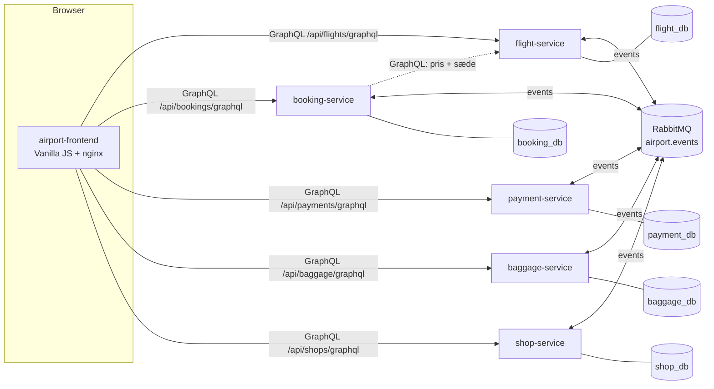
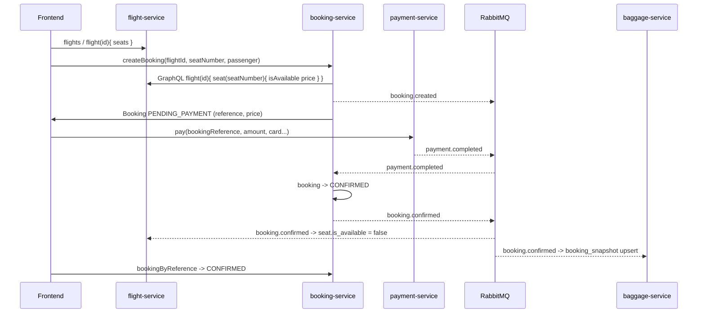
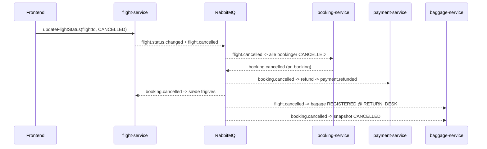
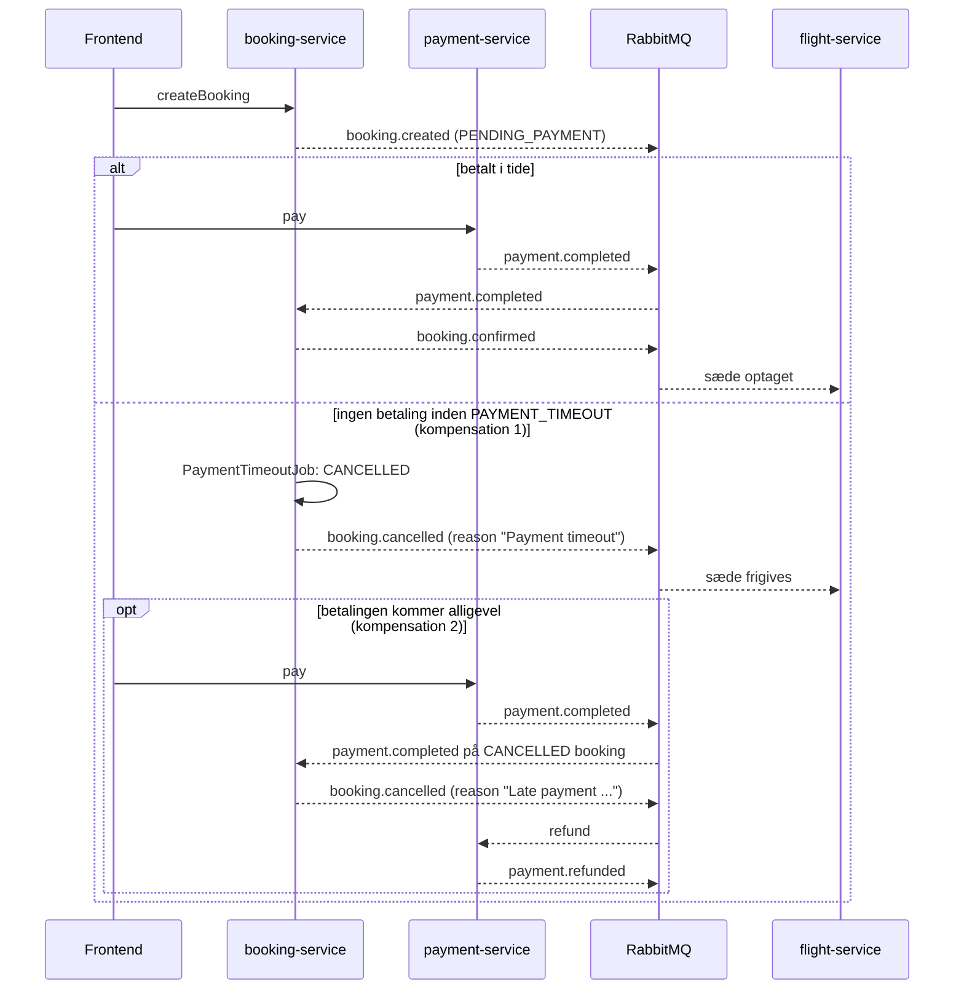
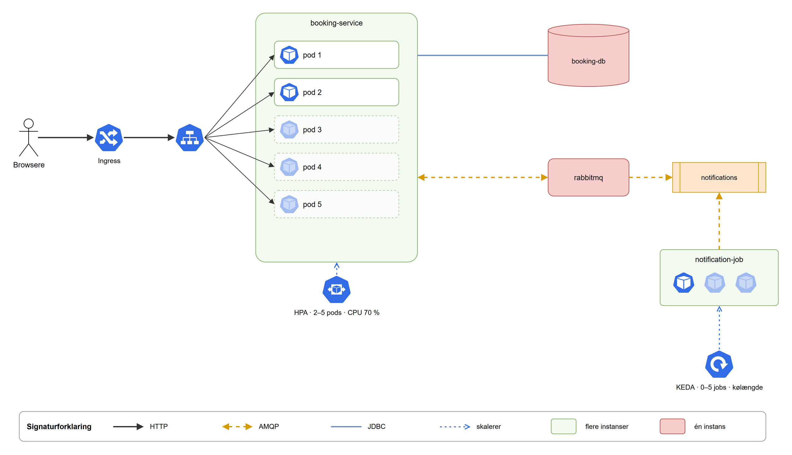
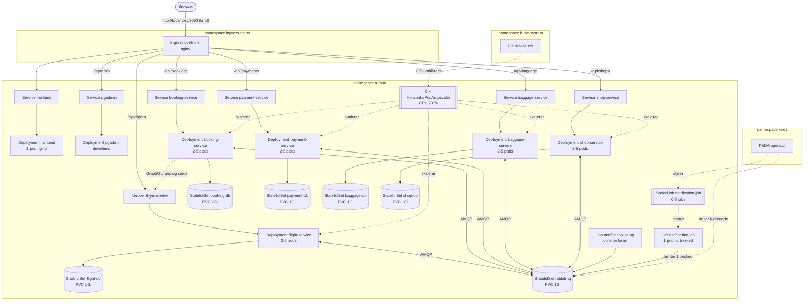
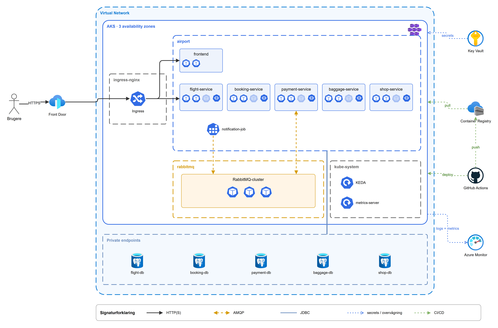

# Arkitektur

## Overblik



```
  [Frontend]  --GraphQL-->  [Flight Service]   ---> flight_db
              --GraphQL-->  [Booking Service]  ---> booking_db   --GraphQL--> Flight Service (pris/sæde)
              --GraphQL-->  [Payment Service]  ---> payment_db
              --GraphQL-->  [Baggage Service]  ---> baggage_db
              --GraphQL-->  [Shop Service]     ---> shop_db

  Alle backend-services <--events--> [RabbitMQ: topic exchange "airport.events"]
```

Regler der overholdes:

* Én PostgreSQL-database pr. service. Ingen service læser i en anden services database.
* Synkront: frontend → service via GraphQL over HTTP (Spring for GraphQL). Kun `/actuator/health` er REST.
* Asynkront: service → service via events på RabbitMQ (se [events.md](events.md)).
* Services cacher snapshots fra events (fx booking gemmer flightnummer, afgangstid, gate og flystatus;
  baggage gemmer `booking_snapshot`). Kilden til sandhed er altid den ejende service.
* Frontend kalder services direkte. I docker-compose via `localhost:808x` med CORS; i Kubernetes via
  én Ingress, hvor frontend og API deler origin.

## Teknologi pr. service

Alle fem backend-services er bygget over samme skabelon (flight-service var den første og de øvrige er
kopier af strukturen):

| Lag         | Pakke        | Indhold                                                                 |
|-------------|--------------|-------------------------------------------------------------------------|
| domain      | `.domain`    | JPA-entiteter, enums, `ApiException` + `ErrorCode`                      |
| repository  | `.repository`| Spring Data JPA repositories (+ Specifications hvor der filtreres)      |
| service     | `.service`   | Forretningslogik, transaktioner, ren domænelogik (pris, regler, Dijkstra) |
| graphql     | `.graphql`   | `@Controller` med `@QueryMapping`/`@MutationMapping`/`@SchemaMapping`, input-records med Bean Validation, `GraphQlExceptionResolver` |
| messaging   | `.messaging` | `EventEnvelope`, `EventPublisher` + `OutboxEvent`/`OutboxRelay` (transactional outbox), consumers + transaktionelle handlers, `ProcessedEvent` (idempotens) |
| config      | `.config`    | RabbitMQ-topologi (exchange, køer, DLQ), GraphQL-scalars                |

Skema og seed-data styres af Flyway (`V1__init.sql`, `V2__seed.sql`, `V{n}__outbox.sql`); Hibernate kører med
`ddl-auto=validate`.

### GraphQL-fejl

Alle fejl returneres i `errors[].extensions.code` med en af koderne
`NOT_FOUND`, `VALIDATION_ERROR`, `INVALID_STATE`, `SEAT_TAKEN`, `UPSTREAM_UNAVAILABLE`, `ALREADY_PAID`,
`BAGGAGE_LIMIT_EXCEEDED`, `ROUTE_NOT_FOUND`, `CONFLICT`, `INTERNAL_ERROR`, `PAYMENT_FAILED`.
`PAYMENT_FAILED` er defineret, men kastes ikke: `pay` returnerer et `Payment` med `status: FAILED` og `failureReason`
i stedet for en GraphQL-fejl (se designvalg nedenfor).
Bean Validation-fejl (`ConstraintViolationException`) mappes til `VALIDATION_ERROR` med feltnavne i beskeden.

### Messaging

* Én topic exchange `airport.events`, routing key = eventnavn.
* Én durable kø pr. service pr. interesse (`<service>.<interesse>-events`), bundet med `<prefix>.#`.
* Retry: Spring AMQP stateless retry, 3 forsøg med eksponentiel backoff; derefter reject → dead-letter
  exchange `airport.events.dlx` → `<service>.dlq`.
* Idempotens: `processed_event(event_id)` skrives i samme transaktion som tilstandsændringen.
* Publicering går gennem en **transactional outbox**: `EventPublisher.publish` rører ikke RabbitMQ, men
  serialiserer envelopen og indsætter den i tabellen `outbox_event` i samme transaktion som
  tilstandsændringen. Tilstand og event committes derfor atomisk (eller rulles tilbage sammen), og
  `publish` fejler hårdt hvis den kaldes uden for en transaktion.
* `OutboxRelay` (`@Scheduled`, hvert 500 ms) sender rækkerne videre: den tager en Postgres advisory lock
  (`pg_try_advisory_xact_lock`), så kun ét relay er aktivt pr. service selv med flere replicas, læser de ældste
  usendte rækker (`ORDER BY id ... FOR UPDATE`), sender batchen med publisher confirms
  (`RabbitTemplate.invoke` + `waitForConfirmsOrDie`) og sætter først `published_at` når brokeren har
  bekræftet. Fejler sendingen (broker nede, nack, timeout) tælles `attempts` op, `last_error` gemmes, og
  rækkerne bliver liggende til næste poll. Backloggen ses som gauge `outbox.pending` (`/actuator/metrics`).
* Garanti: at-least-once fra producent + idempotent consumer (`processed_event`) = effektivt exactly-once.
  Dør relayet mellem bekræftelse og commit, sendes rækken igen med samme `eventId`, og modtageren
  ignorerer duplikatet. Rækkefølgen pr. producent bevares (ét aktivt relay, `ORDER BY id`, en fejlet batch
  gentages som helhed).
* Consumeren parser selv envelope-JSON (ingen `__TypeId__`-magi), så services kan have hver sin kopi af
  `EventEnvelope` uden delt bibliotek.

## Flows

### Flow A – Booking og betaling



1. Frontend henter afgange og sæder fra flight-service.
2. `createBooking` → booking-service validerer sædet og henter prisen synkront hos flight-service,
   gemmer booking i `PENDING_PAYMENT` og publicerer `booking.created`.
   Dobbeltbooking forhindres af et partielt unikt indeks på `(flight_id, seat_number) WHERE status <> 'CANCELLED'`
   → fejlkode `SEAT_TAKEN`.
3. `pay(...)` → payment-service simulerer gateway og publicerer `payment.completed` (eller `payment.failed`).
4. booking-service modtager `payment.completed` → `CONFIRMED` → publicerer `booking.confirmed`
   (`payment.failed` → `CANCELLED` → `booking.cancelled`).
5. flight-service markerer sædet optaget. 6. baggage-service opretter `booking_snapshot`.
7. Frontend poller `bookingByReference` og viser `CONFIRMED`.

### Flow B – Bagage

1. `registerBaggage(reference, 23, CHECKED)` → baggage-service tjekker `booking_snapshot.status ∈ {CONFIRMED, CHECKED_IN}`,
   max 3 CHECKED pr. booking og max 32 kg → tag `BAG-XXXXXXXX`, event `baggage.registered`.
2. `updateBaggageStatus(tag, LOADED, "Belt 4")` → event `baggage.status.changed`.
3. Frontend viser bagage under "Min booking" (`baggageByBooking`).

### Flow C – Aflysning



### Flow D – Navigation

1. Frontend vælger fra-node ("Security T2") og til-node ("Gate B12") blandt `navNodes`.
2. `route(fromNodeId, toNodeId, accessibleOnly)` → Dijkstra over `nav_edge` (kanterne behandles som
   tovejs; `accessibleOnly=true` udelader kanter med `accessible=false`, fx trapper).
3. Svaret indeholder trin-for-trin instruktioner, samlet afstand, estimeret gangtid (80 m/min) og
   `shopsAlongRoute` – butikker hvis node indgår i ruten. Frontend tegner gangnetværket og ruten på et SVG-kort med
   nummererede trin, instruktionstekst pr. trin, afstand pr. delstrækning og retningspile; trin på en anden etage vises som hint.

## Sagaer (Flow A og Flow C)

En booking berører tre databaser (booking_db, payment_db, flight_db). Vi bruger **ikke** distribuerede
transaktioner (2PC/XA): hver service committer sin egen lokale transaktion og publicerer et event via outboxen,
og fejl rettes op med **kompenserende handlinger** i stedet for rollback. Sagaerne er **koreograferede**: der er
ingen central orkestrator, hver service reagerer på events. Det holder services uafhængige, og hvert trin er
idempotent (`processed_event`) og kommutativt (se [events.md](events.md#ordningsgaranti-og-kommutative-handlers)).

### Flow A – booking og betaling

| # | Trin (ejer)                                    | Lokal transaktion                        | Event ud             | Kompensation hvis sagaen ikke kan fuldføres |
|---|------------------------------------------------|------------------------------------------|----------------------|---------------------------------------------|
| 1 | Opret booking (booking-service)                | booking `PENDING_PAYMENT`, sæde reserveret i booking_db | `booking.created`    | **Betalingstimeout:** ingen betaling inden `PAYMENT_TIMEOUT` (15 min) → booking `CANCELLED`, `booking.cancelled` frigiver sædet |
| 2 | Betal (payment-service)                        | payment `COMPLETED` / `FAILED`           | `payment.completed` / `payment.failed` | `payment.failed` → booking `CANCELLED` (trin 1 rulles tilbage) |
| 3 | Bekræft booking (booking-service)              | booking `CONFIRMED`                      | `booking.confirmed`  | **Sen betaling:** `payment.completed` på en booking, der allerede er `CANCELLED` → `booking.cancelled` publiceres igen, og payment-service refunderer automatisk |
| 4 | Optag sæde (flight-service), snapshot (baggage) | `seat.is_available=false`, `booking_snapshot` | –                    | Annulleres bookingen senere: `booking.cancelled` frigiver sædet, snapshot → `CANCELLED` |

Implementering: `PaymentTimeoutJob` (`@Scheduled`, hvert 30 s) kalder `BookingService.cancelExpiredPayments`, som
låser de udløbne rækker med `SELECT ... FOR UPDATE SKIP LOCKED`. Jobbet kører i alle pods (HPA), men hver booking
annulleres kun én gang. `onPaymentCompleted`/`onPaymentFailed` låser bookingrækken (`PESSIMISTIC_WRITE`), så en
betaling og timeouten for samme booking aldrig kører samtidig: enten bekræftes bookingen først (og timeouten springer
den over), eller også annulleres den først (og betalingen refunderes som sen betaling). Ved den sene betaling forbliver
bookingen `CANCELLED`, fordi sædet kan være solgt videre; flight-service ignorerer det gentagne `booking.cancelled`,
hvis en anden booking holder sædet nu.



### Flow C – aflysning af fly

| # | Trin (ejer)                                 | Lokal transaktion                                  | Event ud                                  | Kompensation |
|---|---------------------------------------------|----------------------------------------------------|-------------------------------------------|--------------|
| 1 | Aflys fly (flight-service)                  | flight `CANCELLED` (terminal)                      | `flight.status.changed`, `flight.cancelled` | – (en aflysning fortrydes ikke) |
| 2 | Annullér bookinger (booking-service)        | alle bookinger på flyet `CANCELLED`                | `booking.cancelled` pr. booking           | Betalte bookinger: trin 3 |
| 3 | Refundér (payment-service)                  | COMPLETED payments → `REFUNDED`                    | `payment.refunded`                        | er selv kompensationen for betalingen i Flow A |
| 4 | Frigiv sæder (flight-service)               | `seat.is_available=true`                           | –                                         | – |
| 5 | Bagage til returskranke (baggage-service)   | bagage `REGISTERED` @ `RETURN_DESK`, snapshot `CANCELLED` | –                                   | – |

Sekvensdiagrammet for Flow C står [ovenfor](#flow-c--aflysning). Flow C er en kæde af kompensationer: aflysningen er
det udløsende trin, og trin 2-5 annullerer effekten af Flow A for hver booking på flyet.

Tests: `PaymentSagaIntegrationTest` (booking-service) dækker timeout, betaling i tide og sen betaling;
`PaymentServiceIntegrationTest` dækker refund ved `booking.cancelled`.

## Skalering



*Redigérbar kilde: [diagrams/scaling.drawio](diagrams/scaling.drawio) (draw.io).*

Systemet skalerer vandret: flere pods af den samme service, ikke større maskiner. Det virker, fordi:

* **Stateless pods.** Ingen service holder tilstand i hukommelsen mellem requests: al tilstand ligger i servicens
  database, og en request kan derfor ramme en vilkårlig pod bag Kubernetes-Servicen. Der er ingen sessions
  (frontenden sender alt, hvad der skal bruges, i hvert kald).
* **Én database pr. service.** Hver service har sin egen PostgreSQL (StatefulSet). Last på én service presser ikke de
  andres databaser, og hver database kan dimensioneres for sig. Services kender kun hinandens events, ikke tabeller.
* **Messaging i stedet for kæder af synkrone kald.** Kun `createBooking` kalder en anden service synkront (pris og sæde
  hos flight-service). Resten sker via events: en langsom eller nede service forsinker kun sine egne events, som
  venter i køen, og blokerer ikke brugerens request.
* **Competing consumers.** Alle pods af en service lytter på den samme kø, og RabbitMQ fordeler beskederne mellem
  dem. Flere pods = flere beskeder pr. sekund. At beskeder så kan blive behandlet i en anden rækkefølge, er håndteret
  med idempotente (`processed_event`) og kommutative handlers (se [events.md](events.md#ordningsgaranti-og-kommutative-handlers)).
* **Baggrundsjob tåler flere pods.** Outbox-relayet tager en Postgres advisory lock (kun ét aktivt relay pr. service),
  og betalingstimeouten bruger `FOR UPDATE SKIP LOCKED` (hver booking håndteres af præcis én pod).
* **Read-models.** Services gemmer de data, de læser ofte, lokalt som snapshots fra events: booking har flyets
  gate/status, baggage har `booking_snapshot`. "Min booking" og bagageregistrering kræver derfor ingen kald til andre
  services.
* **Indekser** på alt, der slås op eller filtreres på: fx `booking(booking_reference)`, `booking(passenger_id)`,
  `booking(flight_id)`, unikt `passenger(lower(email))`, `flight(scheduled_departure)`, `flight(destination)`,
  `seat(flight_id)`, `shop(terminal)`, `shop(category)`, `baggage(booking_reference)`, og partielle indekser, der kun
  indeholder de få "aktive" rækker: `outbox_event(id) WHERE published_at IS NULL`,
  `booking(created_at) WHERE status = 'PENDING_PAYMENT'` og det unikke `booking(flight_id, seat_number) WHERE status <> 'CANCELLED'`.
* **Pagination.** Listequeries (`flights`, `shops`, `bookingsByPassenger`) returnerer højst én side:
  `limit` 1-100 (default 50) og `offset` (default 0), sorteret med id som tie-breaker, så siderne er stabile.
  Ændringen er additiv: eksisterende klienter uden argumenterne får de første 50. `shops(filter: {openNow: ...})`
  filtreres i Java (åbningstider), så her skæres siden efter filtreringen.
* **Autoskalering.** Backend-services: HorizontalPodAutoscaler, 2-5 pods ved 70 % CPU (ticket 13). Notifikationer:
  KEDA ScaledJob, 0-5 jobs efter kølængde (ticket 12). Se [k8s/README.md](../k8s/README.md).

Kendte grænser: hver database er én instans (ingen read replicas), og RabbitMQ er én node. Det er de to dele, der
ikke skalerer vandret i denne opsætning; næste skridt ville være en managed PostgreSQL med read replicas og et
RabbitMQ-cluster med quorum queues.

## Kubernetes-deployment


*Redigérbar kilde: [diagrams/kubernetes-deployment.drawio](diagrams/kubernetes-deployment.drawio) (draw.io).*

<details>
<summary>Samme diagram som tekst (Mermaid)</summary>



</details>

| Ressource | Antal | Hvorfor den type |
|---|---|---|
| Deployment + Service + ConfigMap + Secret pr. backend-service | 5 | Stateless; pods kan erstattes og skaleres frit. Config og hemmeligheder uden for imaget |
| HorizontalPodAutoscaler | 5 | 2-5 pods pr. service ud fra CPU (kræver metrics-server) |
| StatefulSet + PVC pr. database | 5 | Fast pod-navn og egen disk, der overlever genstart |
| StatefulSet RabbitMQ + PVC | 1 | Durable køer og beskeder overlever genstart |
| ScaledJob + TriggerAuthentication + setup-Job | 1 | Serverless funktion: Jobs efter kølængde, 0 pods når køen er tom (kræver KEDA) |
| Ingress | 1 | Ét indgangspunkt; frontend og API på samme origin |
| Deployment frontend / pgadmin | 1 + 1 | Statisk nginx; pgAdmin kun til dev/demo |

## Lokal udvikling (docker compose)


*Redigérbar kilde: [diagrams/local-docker.drawio](diagrams/local-docker.drawio) (draw.io).*

`docker compose up --build` starter alle 12 containere på ét Docker-netværk, hvor de finder hinanden på servicenavn
(fx `http://flight-service:8080`). Der er ingen Ingress og ingen skalering: hver container har sin egen port på
localhost, og browseren kalder de fem GraphQL-API'er direkte (CORS tillader `localhost:8080`). notification-job
(KEDA) og HPA findes kun i Kubernetes, se [k8s/README.md](../k8s/README.md#compose-task-126-udeladt-med-vilje).

## Produktionsplan i skyen (hypotetisk)



*Redigérbar kilde: [diagrams/cloud-production-plan.drawio](diagrams/cloud-production-plan.drawio) (draw.io).*

**Ikke implementeret.** Planen viser, hvordan de samme Kustomize-manifests ville køre i en managed Kubernetes
(Azure Kubernetes Service), og hvad der ændres i forhold til kind:

| Lokalt (kind) | I skyen | Hvorfor |
|---|---|---|
| 1 node | Node pool i 3 availability zones + cluster autoscaler | En hel zone kan falde ud; flere noder når HPA ikke kan placere flere pods |
| PostgreSQL som StatefulSet | Azure Database for PostgreSQL Flexible Server, privat endpoint | Backup, HA og patching klares af Azure |
| RabbitMQ, 1 node | RabbitMQ-cluster med 3 noder og quorum queues | Ingen single point of failure. Azure Service Bus er fravalgt: den taler AMQP 1.0, koden bruger 0.9.1 |
| Secrets med dev-værdier i repoet | Azure Key Vault via Secrets Store CSI-driver | Hemmeligheder uden for Git |
| Images bygget lokalt og `kind load` | Azure Container Registry, tag = git-sha | Sporbare versioner, rollback til et kendt image |
| `kubectl apply -k` manuelt | GitHub Actions: test → build → push → deploy (rolling update) | Samme pipeline hver gang |
| Logs med `kubectl logs` | Azure Monitor med managed Prometheus + Grafana, alarmer (fx DLQ > 0) | Fejl findes på tværs af pods og services |

Diagrammet udvides, når security (Keycloak, ticket 2), AI (Ollama, ticket 4) og observability (ticket 14) er merget.

## Designvalg (hvor spec'en gav frihed)

| Emne | Valg | Begrundelse |
|------|------|-------------|
| Pris i booking-service | Synkront GraphQL-kald til flight-service (`RestClient`) ved `createBooking` | Enkelt, altid korrekt pris og sædestatus; ingen kopi af sædedata i booking_db |
| Booking-snapshot | `booking` har ekstra kolonner `gate`, `flight_status`, `currency` | `flight.status.changed`/`flight.gate.changed` har noget at opdatere; vises under "Min booking" |
| Passager | Nøgle = e-mail (case-insensitivt unikt indeks); navn/pas opdateres ved ny booking | Enkel identitet uden login |
| Bookingreference | 6 tegn fra `ABCDEFGHJKLMNPQRSTUVWXYZ23456789` (uden 0/O/1/I), op til 5 forsøg ved kollision | Læsbar og entydig |
| Annullering | Tilladt fra PENDING_PAYMENT, CONFIRMED og CHECKED_IN; `payment.failed` giver årsag "Payment failed: <reason>" | Spec forbyder ikke annullering efter check-in |
| Sædepris | `basePrice` på flight × klassemultiplikator (ECONOMY 1.0, BUSINESS 2.5, FIRST 4.0) | Spec'ens seat-tabel har ingen pris; dette holder prisen i flight-service |
| Sædelayout | Rækker á 6 (A–F), række 1–2 BUSINESS | Deterministisk, samme regel i SQL-seed og `SeatGenerator` |
| Fælles event-envelope | Identisk record kopieret ind i hver service | Ingen delt Maven-modul → hver service bygger uafhængigt med én Dockerfile |
| Event-publicering | Transactional outbox (`outbox_event`) med polling relay, publisher confirms og advisory lock | Dual-write-problemet: en channel-transacted `RabbitTemplate` sender beskeden i en separat AMQP-transaktion, der committes *efter* DB-commit, så et event kan gå tabt imellem de to (broker-genstart, tabt forbindelse, pod dræbt) – og i consumer-handlers maskeres tabet af `processed_event`, fordi det indgående event er registreret som behandlet. Med outboxen er DB-commit den eneste sandhed; relayet leverer at-least-once, og `processed_event` fjerner duplikater |
| Topic-binding | `<prefix>.#` | `*` matcher kun ét segment; `flight.status.changed` har tre |
| GraphQL-path | Hver service serverer på `/api/<x>/graphql` (`GRAPHQL_PATH`) | Samme path lokalt og bag Ingress → ingen rewrite-regler |
| Fejlet betaling | `pay` returnerer `Payment` med `status: FAILED` og `failureReason` | Frontend kan vise årsagen; booking annulleres asynkront via `payment.failed` |
| Betalingsvalidering | Scalar-argumenterne samles i `PayInput` og valideres med en injiceret `Validator` | Feltnavne i fejlbeskeden; spec'ens signatur `pay(bookingReference, amount, ...)` bevares |
| Udløbsdato | `MM/YY` og `MM/YYYY`; kortet gælder til månedens sidste dag; "Card expired" vinder over "0000" | Enkel, forudsigelig simuleringsregel |
| Payment kender ikke bookingen | payment-service har intet booking-snapshot; `ALREADY_PAID` forhindrer dobbeltbetaling af samme reference | Spec kræver kun lytning på `booking.cancelled`; beløbet kommer fra frontenden (bookingens pris) |
| Bagage-snapshot | `booking_snapshot` har ekstra kolonne `flight_id`; `booking.created` gemmes også (PENDING_PAYMENT) | `flight.cancelled` kan matche på id og nummer; ubetalt booking giver `INVALID_STATE` frem for `NOT_FOUND` |
| Bagage-lokation | Registrering sætter `last_location=CHECK_IN`; aflyst fly → `RETURN_DESK` (bagage der er ARRIVED/LOST springes over) | Spec kræver kun RETURN_DESK; CHECK_IN giver en meningsfuld startværdi |
| Navigationsgraf | `nav_edge` gemmes én gang og behandles som tovejs; `accessibleOnly` udelader `accessible=false` (trapper) | Halvt så mange rækker, samme resultat |
| Ruteinstruktioner | Dansk: "Start ved …", "Gå N m til …", "Tag elevatoren/trappen til etage N", "Du er fremme ved …"; gangtid 80 m/min | Tekstbaseret rute som spec'en kræver |
| Åbningstider | `HH:MM-HH:MM` (også over midnat) eller `24/7`, evalueret i `APP_TIMEZONE` (Europe/Copenhagen) | Enkelt format i seed-data |
| Ekstra query | `navEdges(terminal)` i shop-service | Frontenden tegner gangnetværket (kanterne) på SVG-kortet; kanter med `accessible=false` stiples |
| Postgres | 5 separate containere / StatefulSets | Afspejler Kubernetes-opsætningen og "én database pr. service" |
| pgAdmin i Kubernetes | Dev/demo-værktøj i `k8s/tools/` bag Ingress på `/pgadmin`, uden login (desktop mode); de fem databaser forudregistreret (ConfigMap) med kodeord fra en pgpass-fil (Secret) | Viser "én database pr. service" og eventflowet live i en demo; ikke en del af systemet og fjernes med én linje i `kustomization.yaml` |
| Strukturerede logs | Spring Boots indbyggede `logging.structured.format.console=logstash` i `prod`-profil | Ingen ekstra dependency |
| Ubetalte bookinger | Annulleres efter `PAYMENT_TIMEOUT` (default 15 min) af `PaymentTimeoutJob`, se [Sagaer](#sagaer-flow-a-og-flow-c) | Ellers hænger bookingen i `PENDING_PAYMENT` for evigt, og sædet er blokeret i booking_db |
